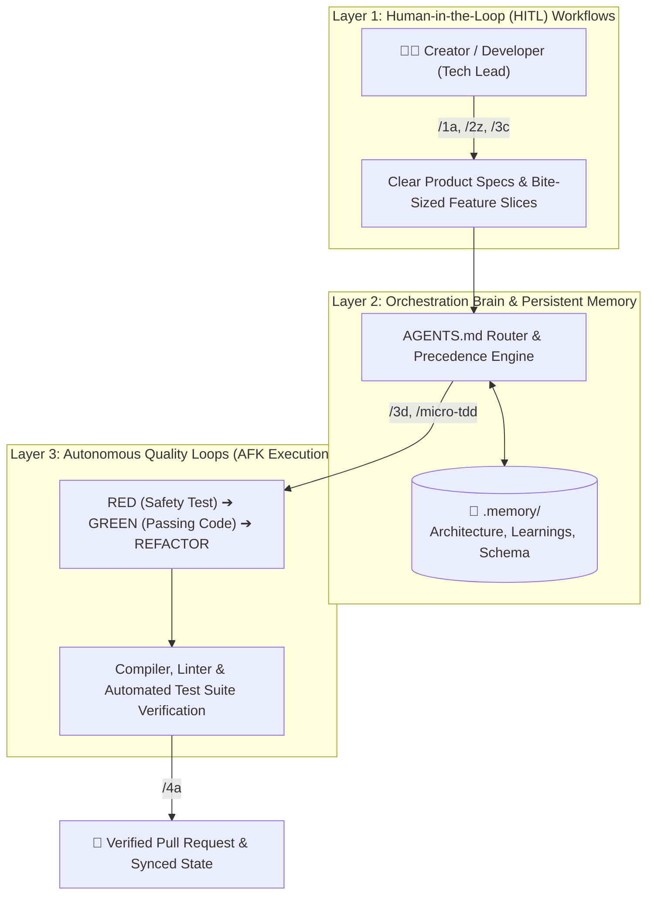

# StratosphereOS


[](https://github.com/PatN-git/Stratosphere-OS)
[](https://github.com/PatN-git/Stratosphere-OS)
[](https://github.com/PatN-git/Stratosphere-OS)
[](https://github.com/PatN-git/Stratosphere-OS)
[](https://github.com/PatN-git/Stratosphere-OS)

> **The structured workspace and operating framework for AI coding assistants.** Equip Google Antigravity, Claude Code, Cursor, Codex, and OpenClaw with persistent project memory, automated quality guardrails, and deterministic lifecycle workflows.
>
> *Designed for everyone—from first-time creators ("vibe coders") building their first app through natural language chat, to seasoned engineers demanding strict architecture governance and zero technical debt.*

---

## Table of Contents
- [Why StratosphereOS?](#why-stratosphereos)
- [⚡ Quick Start & Installation](#-quick-start--installation)
- [How It Works: 3-Layer Architecture](#how-it-works-3-layer-architecture)
- [🎬 A Day in the Life: Shipping a Feature](#-a-day-in-the-life-shipping-a-feature)
- [🧭 Working with StratosphereOS: The Intent Router](#-working-with-stratosphereos-the-intent-router)
- [Workspace Directory Structure & Living Memory](#workspace-directory-structure--living-memory)
- [Dual Issue Tracking (GitHub & Local Air-Gapped)](#dual-issue-tracking-github--local-air-gapped)
- [Lifecycle Skills Matrix](#lifecycle-skills-matrix)
- [Upgrading Framework Files](#upgrading-framework-files-updating)
- [Architecture & Governance](#architecture--governance)

---

## Why StratosphereOS?

### The Problem: AI Coding Without Guardrails
Vanilla AI coding assistants act like enthusiastic junior interns:
- **They jump straight into writing code** before understanding what you actually want.
- **They break features that worked yesterday** because they don't test their work before showing it to you.
- **They forget your architecture and decisions** the moment a chat session ends ("AI Amnesia").

### The Solution: Built for Both Creators and Engineers
Whether you have never written a line of code or have 15 years of software engineering experience, StratosphereOS gives your AI assistant an **invisible safety net and a long-term brain**:

- **For Creators & "Vibe Coders" (Chat-First):** You describe your vision in plain English. The agent guides you across the entire product lifecycle—asking clarifying questions, creating clear requirements, and testing everything automatically so your app doesn't break. If the AI ever gets too technical, just type `/0e-plain-english` to translate it into everyday words!
- **For Engineers & Tech Leads (Discipline & Rigor):** Enforces human-in-the-loop specification sign-offs, isolated Git feature branches, living architectural memory (`.memory/`), and automated Test-Driven Development (TDD) that deterministically blocks regressions before code reaches your main branch.

| Without StratosphereOS | With StratosphereOS |
| :--- | :--- |
| ❌ Agent writes code before understanding requirements | ✅ Agent guides you across the full product lifecycle—asking clarifying questions and planning before coding (see [How It Works](#how-it-works-3-layer-architecture)) |
| ❌ Regressions, bugs, and broken code committed silently | ✅ Automated safety checks (agent writes tests before code, self-correcting bugs until everything passes with zero regressions) |
| ❌ Context and decisions forgotten across chat sessions | ✅ Living `.memory/` knowledge base (`ARCHITECTURE.md`, `LEARNINGS.md`, `GLOSSARY.md`) committed alongside your code |
| ❌ Code sprawl, bloated diffs, and hallucinated libraries | ✅ Clean, surgical changes matching existing patterns with token-efficient design |

---

## ⚡ Quick Start & Installation

Pick the method that best matches your workflow:

### Option A: The 1-Click AI Prompt (Easiest — Zero Terminal Required)
Simply copy and paste this prompt directly into your AI coding assistant (Google Antigravity, Claude Code, Cursor, or ChatGPT):

> **Copy & Paste into Your AI Chat:**
> ```text
> Install the StratosphereOS plugin from https://github.com/PatN-git/Stratosphere-OS using the native plugin installer (e.g. on Google Antigravity run 'agy plugin install https://github.com/PatN-git/Stratosphere-OS', on Claude Code run '/plugin marketplace add PatN-git/Stratosphere-OS' then '/plugin install stratosphere-os@stratosphere-os', or on Cursor run 'npx skills add PatN-git/Stratosphere-OS/dist/skills -a cursor --copy -y'), verify dependencies (Python, Git, GitHub CLI gh), and run /stratosphere-setup to initialize my workspace.
> ```
*Your AI will install the plugin natively, configure your environment, and walk you through setup in plain English.*

---

### Option B: Direct Terminal / CLI Commands

Choose your platform:

| Platform | One-Line Installation Command |
| :--- | :--- |
| **Google Antigravity**<br>*(Recommended — Live Today)* | `agy plugin install https://github.com/PatN-git/Stratosphere-OS`<br>*(Or via the in-app UI: **Customizations > Marketplace** → Search `stratosphere-os` → Click **Install**)* |
| **Claude Code** | `/plugin marketplace add PatN-git/Stratosphere-OS`<br>`/plugin install stratosphere-os@stratosphere-os` |
| **Cursor / Codex / Copilot / OpenClaw**<br>*(via [skills.sh](https://skills.sh))* | `npx skills add PatN-git/Stratosphere-OS/dist/skills -a <agent> --copy -y`<br>*(Supported agents: `cursor`, `claude-code`, `codex`, `github-copilot`, `devin`, `openclaw`, `windsurf`, `zed`. Pass `-g` for global install. Note: `--copy` is required on Windows)* |
| **Offline / Air-Gapped / No Node.js** | Download `dist/skills/` and copy into `.agents/skills/` (or `.claude/skills/`). Works 100% offline without Node or npm! |

---

### Step 2: Initialize Your Workspace
In your project directory, open your agent chat and run:
```text
/stratosphere-setup
```
*The agent will interview you in plain English about your app goals, tech stack, and issue tracking preference, then bootstrap your project structure in seconds.*

---

### Step 3: Start Working with Synced Context
Whenever you open your workspace or start a new day of coding, run:
```text
/0a-start-session
```
*Restores branch state, reloads living memory, and sets up your next work unit with zero cold-start waste.*

---

## How It Works: 3-Layer Architecture

StratosphereOS organizes your development workspace into three cooperating layers:



- **Layer 1: Human-Driven Workflows:** You steer the vision. The agent guides you through ideation, feature design, and task decomposition before writing code.
- **Layer 2: Orchestration Brain & Living Memory:** The agent follows strict rules (`AGENTS.md`) and consults persistent project memory (`.memory/`). It never makes arbitrary architectural decisions without your consent.
- **Layer 3: Autonomous Execution Loops:** For approved tasks, the agent works in self-correcting inner loops (`micro-tdd`)—writing automated tests, verifying code, and fixing mistakes before ever handing the work back to you.

---

## 🎬 A Day in the Life: Shipping a Feature

Here is what a typical feature development cycle looks like in practice (e.g., adding a "Favorites Heart Button" to a recipe app):

### 1. Context Restoration (Zero time wasted)
```text
User: /0a-start-session
Agent: 🪐 StratosphereOS context loaded!
       - Active Branch: feat/recipe-favorites
       - Project Stack: React + Tailwind CSS + SQLite
       - Architecture Rules: All UI components must use Tailwind tokens; no hardcoded styling.
       - Next Task: Add Favorites heart button toggle to RecipeCard component.
```

### 2. Feature Specification & Planning
```text
User: /2z-write-spec
Agent: Let's define the requirements together:
       1. Should the favorite state persist when the user refreshes the page? (Yes)
       2. Should there be an animation when toggled? (Yes, smooth CSS pulse)
       3. Should it work when offline? (Yes, store in localStorage first)
       Specification confirmed! Created task slice: docs/issues/recipe-favorites.md
```

### 3. Automated Test-First Implementation
```text
User: /3d-implement-issue recipe-favorites
Agent: 🧪 Entering automated quality loop:
       [1/3] RED: Wrote test_favorites_toggle.test.tsx -> Failed as expected (FavoritesButton not yet created).
       [2/3] GREEN: Created FavoritesButton with localStorage sync -> All 4 tests passing in 0.35s!
       [3/3] REFACTOR: Cleaned CSS classes, verified zero visual drift against DESIGN.md.
       Committed to branch: feat(favorites): add favorites heart button toggle
```

### 4. Verification & Shipping
```text
User: /4a-verify-and-ship
Agent: 🔍 Running Pre-Flight Quality Audit:
       - Full Test Suite: 24 passed, 0 failed.
       - Acceptance Criteria: All 3 requirements verified against automated tests.
       - Branch pushed: feat/recipe-favorites
       - Created Pull Request #14: "feat: add favorites heart button toggle"
       Ready for review and merge!
```

### 5. Memory Update & Safe Closeout
```text
User: /0b-stop-session
Agent: 💾 Session closed cleanly:
       - Saved note to .memory/LEARNINGS.md: "RecipeCard requires unique key prop when rendering inside favorites list."
       - Updated .memory/STATUS.md. All progress safely checkpointed!
```

---

## 🧭 Working with StratosphereOS: The Intent Router

You don't need to learn 28 commands. In daily work, you only interact with **6 Primary Macro Workflows**:

| What You Want to Do | Primary Command | Friendly Verb | What It Does Under the Hood |
| :--- | :--- | :--- | :--- |
| **Set Up New Project** | `/stratosphere-setup` | `/setup` | Bootstraps `.memory/`, rules, and your issue tracker |
| **Start / Resume Session** | `/0a-start-session` | `/start` | Restores git branch, reloads memory, displays current task context |
| **Plan / Spec a Feature** | `/2z-write-spec` | `/spec` | Interviews you, writes requirements, and creates UI/logic contracts |
| **Build a Feature** | `/3d-implement-issue <id>`| `/implement` | Autonomous test-first implementation loop (`micro-tdd`) |
| **Verify & Ship to PR** | `/4a-verify-and-ship` | `/ship` | Runs full test suite, verifies criteria, pushes branch, opens PR |
| **End / Save Session** | `/0b-stop-session` | `/close` | Saves learnings, checkpoints progress, writes handoff summary |

### Quick Intent Lookup (Common Scenarios)

- **AI is talking in confusing jargon?** → `/0e-plain-english` *(Instantly translates the agent's last message into plain everyday language!)*
- **Want to trace why something happened?** → `/0f-walk-me-through` *(Plain-English explanation of a diff, ticket, or decision)*
- **Have a vague or fuzzy idea?** → `/1a-research` or `/concept-brainstorm` *(Helps explore and structure ideas)*
- **Need a visual HTML roadmap or decision matrix?** → `/plan-html` *(Generates an interactive, standalone HTML document)*
- **Break a big spec into small backlog tasks?** → `/3a-version-planning` ➔ `/3b-create-issue` ➔ `/3c-sprint-planning`
- **Run background tasks completely hands-free?** → `/3z-afk-loop` *(Autonomous start → implement → ship → stop loop)*
- **Audit codebase health and architectural drift?** → `/4b-audit-architecture-drift` or `/4c-codebase-health-audit`
- **Install external community skills on demand?** → `/sync-skills`

---

## Workspace Directory Structure & Living Memory

When initialized via `/stratosphere-setup`, StratosphereOS scaffolds durable project state into your repository:

```text
├── AGENTS.md / CLAUDE.md / GEMINI.md  ← Core constitution and layer rules
├── .agents/                          ← Orchestration engine (rules, workflows, skills)
├── .memory/                          ← Authoritative project memory
│   ├── ARCHITECTURE.md               ← System structural invariants & tracker backend
│   ├── LEARNINGS.md                  ← Accumulated architectural traps and fixes
│   ├── GLOSSARY.md                   ← Project domain vocabulary
│   ├── DATABASE_SCHEMA.md            ← Living database definitions
│   ├── DESIGN.md / DESIGN_RULES.md   ← UI design tokens and structural contracts
│   ├── STATUS.md                     ← Active session state and health (gitignored)
│   └── resume/                       ← Ephemeral session continuity notes (gitignored)
└── docs/                             ← Product Requirement Documents (PRDs) and research
```

### Project Memory & Git Hygiene
StratosphereOS maintains a clean separation between persistent knowledge and ephemeral session state:
- **Tracked in Git:** Authoritative project memory (`ARCHITECTURE.md`, `LEARNINGS.md`, `GLOSSARY.md`, `DATABASE_SCHEMA.md`, `DESIGN.md`, `DESIGN_RULES.md`). These form the living documentation of your system and are committed alongside your code.
- **Gitignored:** Ephemeral session files (`STATUS.md`, `resume/`). These track active session health and in-flight handoff notes, preventing merge conflicts across concurrent branches and worktrees.

---

## Dual Issue Tracking (GitHub & Local Air-Gapped)

StratosphereOS supports two zero-friction issue-tracking backends configured in `.memory/ARCHITECTURE.md` (`tracker: github` or `tracker: local`):

1. **GitHub Issues (`tracker: github`)**:
   - Integrates directly with GitHub Issues, milestones, and project boards via the `gh` CLI.
   - Ideal for open-source repositories and teams collaborating on GitHub.

2. **Local Tracker (`tracker: local`)**:
   - Stores each issue as a standalone markdown document (`docs/issues/<id>.md`) on an isolated `<repo>/issues` Git branch.
   - Every feature branch, worktree, and offline environment reads and updates issues via `issues.py` with **zero merge conflicts** and zero external dependencies.
   - Ideal for private offline work, air-gapped environments, or solo development.

### Interactive Kanban Board & CLI
StratosphereOS includes a high-performance CLI utility (`.agents/scripts/issues.py`) to manage issues across both backends:

```bash
# Open the visual interactive Kanban board in your browser
python .agents/scripts/issues.py board --open

# View a live summary table across all milestones and epics
python .agents/scripts/issues.py summary

# List, view, or filter issues
python .agents/scripts/issues.py list
python .agents/scripts/issues.py view <id>

# Seamlessly switch between GitHub and Local tracker backends
python .agents/scripts/tracker_switch.py --to github
python .agents/scripts/tracker_switch.py --to local
```

---

## Lifecycle Skills Matrix

StratosphereOS provides 28 structured skills spanning the entire development lifecycle. Each installs to `.agents/skills/<name>/SKILL.md` and is invoked as `/<name>` on Google Antigravity, Claude Code, Cursor, Codex, Devin, and OpenClaw.

<details open>
<summary><b>Expand Full 28-Skill Reference Matrix (Click to collapse/expand)</b></summary>

<br/>

| Stage | Command | Purpose & Rationale | Reads | Produces |
|:---|:---|:---|:---|:---|
| **0. Session Management** | `/0a-start-session` | Eliminates cold-start costs by restoring branch state and loading durable memory. | `STATUS`, `.memory/*` | Synced session context |
| | `/0b-stop-session`<br/>`/0c-handoff` | Lints project memory, updates status ground truth, stages resume notes, and prepares clean handoffs. | Session work | Updated `STATUS.md`, resume note, handoff brief |
| | `/0d-nightly-consolidation` | Consolidates ephemeral session learnings and prunes outdated scratch state. | `.memory/*`, git logs | Consolidated learnings, clean memory |
| | `/load-memory` | Read-only reconstruction of active project memory and architecture invariants. | `.memory/*` | Loaded agent context |
| **0. Anytime Utilities** | `/0e-plain-english` | Restates the agent's last message or question in plain, non-technical English. | Last agent message | Plain-language explanation |
| | `/0f-walk-me-through` | Traces why a result happened, or predicts behavior, in plain words (≤ 3 tool calls). | Ticket, commit, or diff | Step-by-step walkthrough |
| **1. Discovery & Ideation** | `/1a-research`<br/>`/1b-concept-framing`<br/>`/1c-concept-map` | Investigates domain context, deconstructs fuzzy ideas, and maps multi-entity dependency trees. | `.memory/*` | Discovery brief, glossary terms, entity maps |
| | `/concept-brainstorm` | Divergent/convergent ideation loop (Constraints → Diverge → Triage → Validate). | Brief, domain ideas | Prioritized concepts, structured trade-offs |
| **2. Design & Contracts** | `/2a-write-prd`<br/>`/2b-interface-design` | Derives formal PRDs and UI/API contracts to prevent hallucinations and drift. | Discovery brief | PRD doc, UI/logic contracts |
| | `/2c-reconcile-specs` | Cross-audits PRD, interface design, architecture, and database schemas for consistency. | PRD, design, schema | Reconciled specifications |
| | `/2z-write-spec` | Orchestrates `/2a` → `/2b` → `/2c` in one invocation with unified memory and decision log. | Discovery brief, `.memory/*` | PRD doc, design doc, reconciled specs |
| **3. Planning & Decomposition** | `/3a-version-planning`<br/>`/3b-create-issue`<br/>`/3c-sprint-planning` | Deconstructs PRDs into roadmap milestones and context-sized vertical slice issues. | PRD, tracker | Release roadmap, sprint plan, vertical issues |
| | `/plan-html` | Generates standalone, interactive HTML plans, roadmaps, and trade-off matrices. | Markdown plans, tables | Self-contained interactive HTML file |
| **4. Autonomous Execution** | `/3d-implement-issue` | Implements vertical slices via autonomous `micro-tdd`: test-first RED → GREEN → REFACTOR. | Issue, `ARCHITECTURE` | Passing unit tests, surgical code commits |
| | `/3z-afk-loop` | Runs autonomous end-to-end loops for `type:AFK` issues (start → implement → ship → stop). | Issues, `STATUS` | Automated PRs and updated status |
| | `/micro-tdd` | Inner TDD engine: routes code changes via cheapest safe path (direct, visual, or test-first). | Failing test / target code | Passing tests, refactored code |
| **5. Ship & Quality Audit** | `/4a-verify-and-ship` | Audits acceptance criteria against automated test suites, pushes branch, and opens/updates PR. | Issue, tests, codebase | Verification audit, pushed branch, tracked PR |
| | `/4b-audit-architecture-drift`<br/>`/4c-codebase-health-audit` | Audits codebase against `ARCHITECTURE.md` invariants and screens 6 passes of broad codebase health. | Codebase, `.memory/*` | Drift audit report, health audit report |
| **6. Scaffolding & Maintenance** | `/stratosphere-setup` | Scaffolds initial `.memory/` layer, constitution, rules, and issue tracker. | User requirements | Initialized StratOS workspace |
| | `/stratosphere-update` | Upgrades framework templates, rules, and skills in-place without touching user memory. | `.memory/*`, lockfile | Upgraded framework files |
| | `/sync-skills` | Discovers, installs, and synchronizes external domain and ecosystem skills on demand. | `external-skills.json` | Installed external skills |

</details>

---

## Upgrading Framework Files (Updating)

To upgrade an already-instantiated project to later plugin versions, run:
```text
/stratosphere-update
```
Your `.memory/` data and constitution are never overwritten; framework-owned blocks are updated in place, and you confirm any conflicts.

> [!TIP]
> **Keeping the Plugin Fresh**
> - **Google Antigravity users:** updates can be reinstalled anytime with `agy plugin install https://github.com/PatN-git/Stratosphere-OS` (or via **Customizations > Marketplace** once listed).
> - **Claude Code users:** updates arrive through `/plugin update stratosphere-os` or automatically if `autoUpdate` is enabled.
> - **skills.sh users:** `npx skills update`.
> - **Direct copy users:** copy updated skills from the new release into your skills directory.

---

## Architecture & Governance

### Open Knowledge Format (OKF) Conformance
StratosphereOS conforms to the [Open Knowledge Format (OKF) v0.2 Specification](https://github.com/GoogleCloudPlatform/knowledge-catalog/tree/main/okf). The `.memory/` and `docs/` directories form a structured knowledge bundle. An interactive HTML graph visualizer can be generated anytime via `python .agents/scripts/okf_view.py`.

### UI Stack & Design Tooling
By default, UI projects assume React + Tailwind CSS + shadcn/ui. Non-UI projects rely on clean interface contracts defined during `/2b-interface-design`. Google Stitch design integration is supported automatically when enabled in workspace settings.
