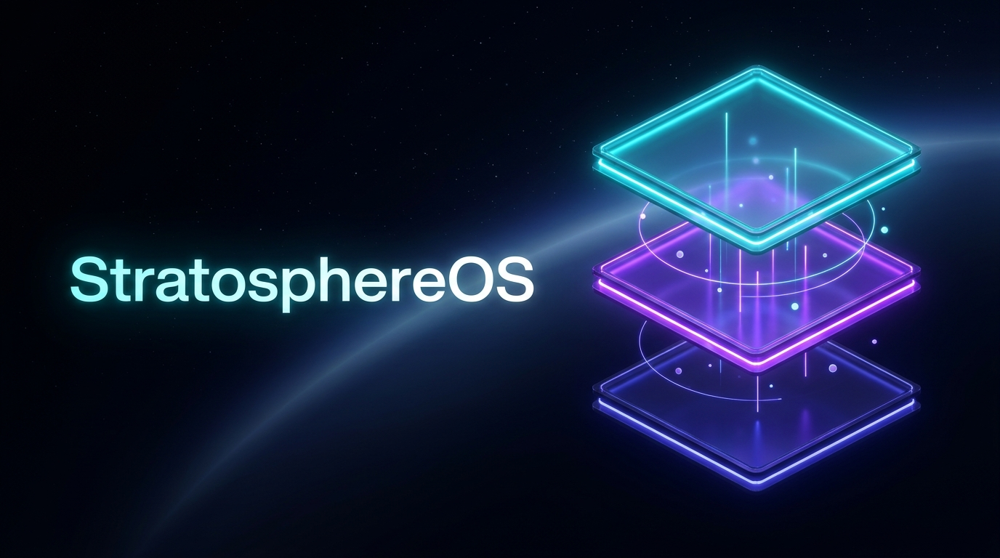

# Stratosphere-OS


[](https://github.com/PatN-git/Stratosphere-OS)
[](https://github.com/PatN-git/Stratosphere-OS)
[](https://github.com/PatN-git/Stratosphere-OS)
[](https://github.com/PatN-git/Stratosphere-OS)

> An agentic orchestration framework that equips AI coding assistants (Claude Code, Google Antigravity, Cursor, Codex, OpenClaw) with structured memory, automated TDD guardrails, and deterministic project lifecycles. Developed out of frustration with unstructured AI workflows and inspired by popular skill builders.

---

## Table of Contents
- [Why StratosphereOS?](#why-stratosphereos)
- [Workspace Directory Structure](#workspace-directory-structure)
- [Dual Issue Tracking (GitHub & Local)](#dual-issue-tracking-github--local)
- [Lifecycle Skills Matrix](#lifecycle-skills-matrix)
- [Getting Started (Installation)](#getting-started-installation)
- [Upgrading Framework Files](#upgrading-framework-files-updating)
- [Architecture & Governance](#architecture--governance)

---

## Why StratosphereOS?

### Beyond Unstructured Code Generation
In modern AI software development, ad-hoc chat prompting quickly leads to architectural drift, subtle bugs, and unmaintainable technical debt. StratosphereOS addresses this by enforcing **Human-in-the-Loop (HITL) architecture governance**.

Developers act as **Loop Engineers**—interviewing the agent, stress-testing specifications, and establishing clear UI and logic contracts before any implementation begins. Once the human explicitly approves the requirements, small vertical slices are delegated to autonomous test-driven loops (`micro-tdd`) that execute independently until all compiler and test suite checks pass.

StratosphereOS structures your workspace into three cooperating layers:
1. **Layer 1: Workflows (Human Driven)** — Interactive lifecycle stages (Discover, Design, Slice) ensuring alignment before code generation.
2. **Layer 2: Orchestration Brain** — The agent router governing tool execution and strict precedence rules.
3. **Layer 3: Autonomous Execution** — Self-correcting inner loops (like test suites and linters) running deterministically against local code.

---

## Workspace Directory Structure

When initialized via `/stratosphere-setup`, StratosphereOS scaffolds durable project state into your repository:

```text
├── AGENTS.md / CLAUDE.md / GEMINI.md  ← Core constitution and layer rules
├── .agents/                          ← Orchestration engine (rules, workflows, skills)
├── .memory/                          ← Authoritative project memory
│   ├── ARCHITECTURE.md               ← System structural invariants & tracker backend
│   ├── LEARNINGS.md                  ← Accumulated architectural traps and fixes
│   ├── GLOSSARY.md                   ← Project domain vocabulary
│   ├── DATABASE_SCHEMA.md            ← Living database definitions
│   ├── DESIGN.md / DESIGN_RULES.md   ← UI design tokens and structural contracts
│   ├── STATUS.md                     ← Active session state and health (gitignored)
│   └── resume/                       ← Ephemeral session continuity notes (gitignored)
└── docs/                             ← Product Requirement Documents (PRDs) and research
```

### Project Memory & Git Hygiene
StratosphereOS maintains a clean separation between persistent knowledge and ephemeral session state:
- **Tracked in Git:** Authoritative project memory (`ARCHITECTURE.md`, `LEARNINGS.md`, `GLOSSARY.md`, `DATABASE_SCHEMA.md`, `DESIGN.md`, `DESIGN_RULES.md`). These files form the living documentation of your system and are committed alongside your code.
- **Gitignored:** Ephemeral session files (`STATUS.md`, `resume/`). These track active session health and in-flight handoff notes, preventing unnecessary merge conflicts across concurrent branches and worktrees.

---

## Dual Issue Tracking (GitHub & Local)

StratosphereOS supports two zero-friction issue-tracking backends configured in `.memory/ARCHITECTURE.md` (`tracker: github` or `tracker: local`):

1. **GitHub Issues (`tracker: github`)**:
   - Integrates directly with GitHub Issues, milestones, and project boards via the `gh` CLI.
   - Ideal for open-source repositories and teams collaborating on GitHub.

2. **Local Tracker (`tracker: local`)**:
   - Stores each issue as a standalone markdown document (`docs/issues/<id>.md`) on an isolated `<repo>/issues` Git branch.
   - Every feature branch, worktree, and offline environment reads and updates issues via `issues.py` with **zero merge conflicts** and zero external dependencies.
   - Ideal for private offline work, air-gapped environments, or solo development.

### Tracker Management CLI
StratosphereOS includes a high-performance CLI utility (`.agents/scripts/issues.py`) to manage issues across both backends:

```bash
# View a live summary table across all milestones and epics
python .agents/scripts/issues.py summary

# Open the visual interactive Kanban board in your browser
python .agents/scripts/issues.py board --open

# List, view, or filter issues
python .agents/scripts/issues.py list
python .agents/scripts/issues.py view <id>

# Seamlessly switch between GitHub and Local tracker backends
python .agents/scripts/tracker_switch.py --to github
python .agents/scripts/tracker_switch.py --to local
```

---

## Lifecycle Skills Matrix

StratosphereOS provides 28 structured skills spanning the entire development lifecycle. Each installs to `.agents/skills/<name>/SKILL.md` and is invoked as `/<name>` on Claude Code, Antigravity, Cursor, Codex, Devin, and OpenClaw.

| Stage | Command | Purpose & Rationale | Reads | Produces |
|:---|:---|:---|:---|:---|
| **0. Session Management** | `/0a-start-session` | Eliminates cold-start costs by restoring branch state and loading durable memory. | `STATUS`, `.memory/*` | Synced session context |
| | `/0b-stop-session`<br/>`/0c-handoff` | Lints project memory, updates status ground truth, stages resume notes, and prepares clean handoffs. | Session work | Updated `STATUS.md`, resume note, handoff brief |
| | `/0d-nightly-consolidation` | Consolidates ephemeral session learnings and prunes outdated scratch state. | `.memory/*`, git logs | Consolidated learnings, clean memory |
| | `/load-memory` | Read-only reconstruction of active project memory and architecture invariants. | `.memory/*` | Loaded agent context |
| **0. Anytime Utilities** | `/0e-plain-english` | Restates the agent's last message or question in plain, non-technical English. | Last agent message | Plain-language explanation |
| | `/0f-walk-me-through` | Traces why a result happened, or predicts behavior, in plain words (≤ 3 tool calls). | Ticket, commit, or diff | Step-by-step walkthrough |
| **1. Discovery & Ideation** | `/1a-research`<br/>`/1b-concept-framing`<br/>`/1c-concept-map` | Investigates domain context, deconstructs fuzzy ideas, and maps multi-entity dependency trees. | `.memory/*` | Discovery brief, glossary terms, entity maps |
| | `/concept-brainstorm` | Divergent/convergent ideation loop (Constraints → Diverge → Triage → Validate). | Brief, domain ideas | Prioritized concepts, structured trade-offs |
| **2. Design & Contracts** | `/2a-write-prd`<br/>`/2b-interface-design` | Derives formal PRDs and UI/API contracts to prevent hallucinations and drift. | Discovery brief | PRD doc, UI/logic contracts |
| | `/2c-reconcile-specs` | Cross-audits PRD, interface design, architecture, and database schemas for consistency. | PRD, design, schema | Reconciled specifications |
| | `/2z-write-spec` | Orchestrates `/2a` → `/2b` → `/2c` in one invocation with unified memory and decision log. | Discovery brief, `.memory/*` | PRD doc, design doc, reconciled specs |
| **3. Planning & Decomposition** | `/3a-version-planning`<br/>`/3b-create-issue`<br/>`/3c-sprint-planning` | Deconstructs PRDs into roadmap milestones and context-sized vertical slice issues. | PRD, tracker | Release roadmap, sprint plan, vertical issues |
| | `/plan-html` | Generates standalone, interactive HTML plans, roadmaps, and trade-off matrices. | Markdown plans, tables | Self-contained interactive HTML file |
| **4. Autonomous Execution** | `/3d-implement-issue` | Implements vertical slices via autonomous `micro-tdd`: test-first RED → GREEN → REFACTOR. | Issue, `ARCHITECTURE` | Passing unit tests, surgical code commits |
| | `/3z-afk-loop` | Runs autonomous end-to-end loops for `type:AFK` issues (start → implement → ship → stop). | Issues, `STATUS` | Automated PRs and updated status |
| | `/micro-tdd` | Inner TDD engine: routes code changes via cheapest safe path (direct, visual, or test-first). | Failing test / target code | Passing tests, refactored code |
| **5. Ship & Quality Audit** | `/4a-verify-and-ship` | Audits acceptance criteria against automated test suites, pushes branch, and opens/updates PR. | Issue, tests, codebase | Verification audit, pushed branch, tracked PR |
| | `/4b-audit-architecture-drift`<br/>`/4c-codebase-health-audit` | Audits codebase against `ARCHITECTURE.md` invariants and screens 6 passes of broad codebase health. | Codebase, `.memory/*` | Drift audit report, health audit report |
| **6. Scaffolding & Maintenance** | `/stratosphere-setup` | Scaffolds initial `.memory/` layer, constitution, rules, and issue tracker. | User requirements | Initialized StratOS workspace |
| | `/stratosphere-update` | Upgrades framework templates, rules, and skills in-place without touching user memory. | `.memory/*`, lockfile | Upgraded framework files |
| | `/sync-skills` | Discovers, installs, and synchronizes external domain and ecosystem skills on demand. | `external-skills.json` | Installed external skills |

---

## Getting Started (Installation)

### 1. Install the Skills
StratosphereOS ships as one canonical bundle, `dist/skills/` (28 skills, with HITL sidecars and references intact). Pick the track that matches your situation. Installing skills never writes `.memory/`, `AGENTS.md` or rules — that is `/stratosphere-setup` (step 2).

> **Trust the project first (Codex, Gemini CLI).** Codex >= 0.150.0 skips project `AGENTS.md` until the project is trusted, and Gemini CLI >= 0.59.0 fails closed on untrusted workspaces. Nothing errors: on Codex the skills can still appear (reported, not verified) while the constitution's precedence, security and git rules are absent. Trust the folder in the host before `/stratosphere-setup`; a skill cannot check this for you.

| Your situation | Use |
|:---|:---|
| Any host (Cursor, Codex, Copilot, Devin, OpenClaw, Windsurf, Zed, …) with Node.js | [Track A](#track-a--skillssh-npx) |
| Google Antigravity (native 1-click install or CLI) | [Track B](#track-b--google-antigravity-marketplace) |
| Claude Code, want auto-updating skills | [Track C](#track-c--claude-code-marketplace) |
| Offline, air-gapped, or no Node.js | [Track D](#track-d--direct-copy-offline--no-nodejs) |

### Track A — skills.sh (`npx`)
```bash
# Project-level, into one agent's skills directory
npx skills add PatN-git/Stratosphere-OS/dist/skills -a <agent> --copy -y

# Global (user-level)
npx skills add PatN-git/Stratosphere-OS/dist/skills -g -a <agent> --copy -y

# Later, refresh
npx skills update
```
`<agent>` is a [skills.sh](https://github.com/vercel-labs/skills) agent id, e.g. `claude-code`, `cursor`, `codex`, `github-copilot`, `devin`, `openclaw`, `windsurf`, `zed`; repeat `-a` for several agents. Run `npx skills add --help` for the full list.

- **Always pass `--copy`.** Without it the CLI symlinks, which fails on Windows without Developer Mode (`EPERM: operation not permitted, symlink`) and breaks hosts that do not follow symlinks into `references/`.
- **Always include the `/dist/skills` subpath.** The bundle lives there; the repository root is not a skills root.
- **Keep `-y`** so all 28 skills install; picking a subset breaks lifecycle hand-offs (e.g. `3d` → `4a`).
- No network? Run it against a local clone: `npx skills add ./dist/skills -a <agent> --copy -y`.

### Track B — Google Antigravity Marketplace
Install with a single click inside the Google Antigravity App, or via the command line:

- **Antigravity App UI:** Open the left sidebar, navigate to **Customizations > Marketplace**, search for `stratosphere-os`, and click **Install**.
- **Antigravity CLI:**
  ```text
  /plugin install stratosphere-os
  ```
All 28 skills are immediately discoverable via progressive disclosure. Project setup (`/stratosphere-setup`) and updates (`/stratosphere-update`) automatically resolve their bundled templates and scripts.

### Track C — Claude Code marketplace
```text
/plugin marketplace add PatN-git/Stratosphere-OS
/plugin install stratosphere-os@stratosphere-os
```

### Track D — Direct copy (offline / no Node.js)
Needs only a copy of this repo's `dist/skills/` — from `git clone https://github.com/PatN-git/Stratosphere-OS.git`, a release/ZIP download, or a USB stick. It works fully offline and air-gapped: no Node.js, `npx`, network or shell scripts required. Run the block for your shell from your **project root**, replacing `<repo>` with the path to that copy:

```bash
# macOS / Linux — universal .agents/skills (Cursor, Codex, Antigravity, Devin, OpenClaw, …)
mkdir -p .agents/skills && cp -r <repo>/dist/skills/* .agents/skills/
# Claude Code workspace
mkdir -p .claude/skills && cp -r <repo>/dist/skills/* .claude/skills/
```
```powershell
# Windows PowerShell — universal .agents\skills
New-Item -ItemType Directory -Force -Path .agents\skills
Copy-Item -Recurse -Force <repo>\dist\skills\* .agents\skills\
# Claude Code workspace
New-Item -ItemType Directory -Force -Path .claude\skills
Copy-Item -Recurse -Force <repo>\dist\skills\* .claude\skills\
```
Copy the whole folders — each skill's `agents/` sidecar and `references/` are what keep lifecycle skills user-invoked only.

> [!TIP]
> **Zero-Click AI Installation Shortcut**
> Want your agent to handle the installation, dependency checks, and GitHub integration automatically? Simply paste this prompt into your chat:
> `Install StratosphereOS from this repository: https://github.com/PatN-git/Stratosphere-OS. Check dependencies (Python, Git, GitHub CLI gh), verify GitHub auth/connection, and assist with setup if needed.`

### 2. Instantiate Project Memory
After installing the skills, restart your app or agent session, navigate to your target project repository, and run:
```text
/stratosphere-setup
```
This interactive skill bootstraps the initial `.memory/` state layer, constitution files, and domain skills for new projects.

### 3. Upgrading Framework Files (Updating)
To upgrade an already-instantiated project to later plugin versions, run:
```text
/stratosphere-update
```
Your `.memory/` data and constitution are never overwritten; framework-owned blocks are updated in place, and you confirm any conflicts.

> [!TIP]
> **Keeping the Plugin Fresh**
> - **Claude Code users (Track C):** updates arrive through `/plugin update stratosphere-os` or automatically if `autoUpdate` is enabled.
> - **Track A users:** `npx skills update`.
> - **Google Antigravity users (Track B):** updates arrive automatically or can be installed via the **Customizations > Marketplace** tab in the Antigravity App or `/plugin install stratosphere-os`.
> - **Track D users:** copy updated skills from the new release into your skills directory.

---

## Architecture & Governance

### Open Knowledge Format (OKF) Conformance
StratosphereOS conforms to the [Open Knowledge Format (OKF) v0.2 Specification](https://github.com/GoogleCloudPlatform/knowledge-catalog/tree/main/okf). The `.memory/` and `docs/` directories form a structured knowledge bundle. An interactive HTML graph visualizer can be generated anytime via `python .agents/scripts/okf_view.py`.

### UI Stack & Design Tooling
By default, UI projects assume React + Tailwind CSS + shadcn/ui. Non-UI projects rely on clean interface contracts defined during `/2b-interface-design`. Google Stitch design integration is supported automatically when enabled in workspace settings.
