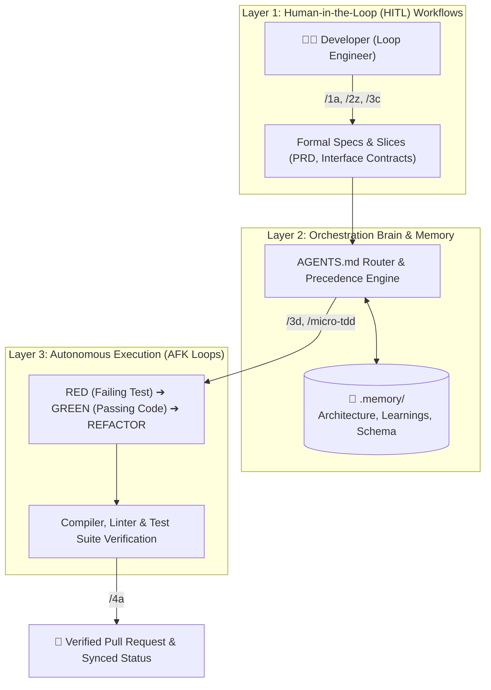

# StratosphereOS


[](https://github.com/PatN-git/Stratosphere-OS)
[](https://github.com/PatN-git/Stratosphere-OS)
[](https://github.com/PatN-git/Stratosphere-OS)
[](https://github.com/PatN-git/Stratosphere-OS)
[](https://github.com/PatN-git/Stratosphere-OS)

> **The deterministic operating system for AI coding assistants.** Equip Google Antigravity, Claude Code, Cursor, Codex, and OpenClaw with persistent project memory, automated TDD guardrails, and structured lifecycle governance.

---

## Table of Contents
- [Why StratosphereOS?](#why-stratosphereos)
- [⚡ Quick Start (30 Seconds)](#-quick-start-30-seconds)
- [How It Works: 3-Layer Orchestration](#how-it-works-3-layer-orchestration)
- [🎬 A Day in the Life: Shipping a Feature](#-a-day-in-the-life-shipping-a-feature)
- [🧭 How to Work with StratosphereOS (Intent Router)](#-how-to-work-with-stratosphereos-intent-router)
- [Workspace Structure & Living Memory](#workspace-structure--living-memory)
- [Dual Issue Tracking (GitHub & Local Air-Gapped)](#dual-issue-tracking-github--local-air-gapped)
- [Lifecycle Skills Matrix](#lifecycle-skills-matrix)
- [Installation Tracks (Detailed Guide)](#installation-tracks-detailed-guide)
- [Upgrading Framework Files](#upgrading-framework-files-updating)
- [Architecture & Governance](#architecture--governance)

---

## Why StratosphereOS?

### The Problem: AI Coding Without Guardrails
Vanilla AI coding assistants act like enthusiastic junior interns—they jump straight to writing speculative code, hallucinate third-party APIs, break existing test suites, and forget your architecture the moment a chat session ends ("AI Amnesia").

### The Solution: Human-in-the-Loop Governance + Autonomous TDD
StratosphereOS transforms your agent from a chatty assistant into a disciplined software engineer:
1. **Loop Engineers (Human):** You act as the Tech Lead—specifying requirements, interviewing the agent, stress-testing PRDs, and setting interface contracts before code generation begins.
2. **Deterministic Memory (`.memory/`):** Living architecture documentation, accumulated bug traps, and domain vocabulary persist across all sessions and team members.
3. **Autonomous Execution (`micro-tdd`):** Once requirements are approved, the agent executes small, vertical slices independently in self-correcting RED→GREEN→REFACTOR loops until all tests pass.

| Without StratosphereOS | With StratosphereOS |
| :--- | :--- |
| ❌ Agent writes code before understanding requirements | ✅ Agent interviews you (`/2a`), defining formal PRDs & UI contracts first |
| ❌ Regressions and broken tests committed silently | ✅ Strict TDD Red→Green→Refactor (`/micro-tdd`) on isolated branches |
| ❌ Architectural context lost across chat sessions | ✅ Living `.memory/` layer (`ARCHITECTURE.md`, `LEARNINGS.md`, `GLOSSARY.md`) |
| ❌ Code sprawl and hallucinated dependencies | ✅ Token-efficient, surgical diffs matching existing project patterns |

---

## ⚡ Quick Start (30 Seconds)

### Step 1: Install Skills into Your Agent

| Agent / Environment | Install Command |
| :--- | :--- |
| **Google Antigravity** | `agy plugin install https://github.com/PatN-git/Stratosphere-OS` |
| **Claude Code** | `/plugin marketplace add PatN-git/Stratosphere-OS`<br>`/plugin install stratosphere-os@stratosphere-os` |
| **Cursor / Codex / Any Host** | `npx skills add PatN-git/Stratosphere-OS/dist/skills -a cursor --copy -y` |
| **Offline / Air-Gapped** | Copy `dist/skills/` directly to `.agents/skills/` |

---

### Step 2: Initialize Project Memory
In your project directory, open your agent chat and run:
```text
/stratosphere-setup
```
*Bootstraps `.memory/`, `ARCHITECTURE.md`, constitution rules, and your issue tracker in seconds.*

---

### Step 3: Start Working with Synced Context
```text
/0a-start-session
```
*Restores branch state, loads living memory, and sets up your next work unit with zero cold-start waste.*

> [!TIP]
> **Zero-Click AI Setup Shortcut**
> Want your agent to handle the installation and setup automatically? Paste this prompt into your agent chat:  
> `Install StratosphereOS from this repository: https://github.com/PatN-git/Stratosphere-OS. Check dependencies (Python, Git, GitHub CLI gh), verify GitHub auth/connection, and run /stratosphere-setup to initialize the workspace.`

---

## How It Works: 3-Layer Orchestration

StratosphereOS organizes your development workspace into three cooperating layers:



- **Layer 1: Workflows (Human-Driven)** — Interactive lifecycle stages (Discover, Design, Slice) ensuring alignment and contract clarity before code generation.
- **Layer 2: Orchestration Brain** — Governs tool execution, token budgets, and strict precedence rules (`AGENTS.md`). Keeps living memory synced and prevents agent drift.
- **Layer 3: Autonomous Execution** — Self-correcting inner loops (`micro-tdd`) running deterministically against local code until all tests pass.

---

## 🎬 A Day in the Life: Shipping a Feature

Here is how a real 15-minute feature development loop works:

### 1. Morning Cold-Start (0 seconds wasted)
```text
User: /0a-start-session
Agent: 🪐 StratosphereOS context loaded.
       - Active Branch: feat/BT-014-oauth-auth
       - Active Milestone: v1.2 (Social Login)
       - Invariants: Postgres via Supabase, strict TDD, no direct commits to main.
       - Next Up: Issue #14: Implement GitHub OAuth callback handler.
```

### 2. Autonomous TDD Implementation
```text
User: /3d-implement-issue 14
Agent: 🧪 Entering micro-tdd inner loop:
       [1/3] RED: Created test_oauth_callback.py -> 1 test failed (OAuthHandler undefined).
       [2/3] GREEN: Implemented OAuthHandler in auth/oauth.py -> All tests passing (3 passed in 0.42s).
       [3/3] REFACTOR: Cleaned token extraction, verified zero architecture drift against ARCHITECTURE.md.
       Committed: feat(BT-014): implement github oauth callback handler
```

### 3. Verification & Shipping
```text
User: /4a-verify-and-ship
Agent: 🔍 Running Pre-Flight Audit:
       - Full Test Suite: 48 passed, 0 failed.
       - Acceptance Criteria: All 3 criteria verified against unit tests.
       - Pushed branch: feat/BT-014-oauth-auth
       - Opened Pull Request #22: "feat(BT-014): implement github oauth callback handler"
       Ready for human review!
```

### 4. Session Closeout & Memory Persistence
```text
User: /0b-stop-session
Agent: 💾 Saved session state:
       - Recorded trap in .memory/LEARNINGS.md: "OAuth token exchange requires explicit state nonce verification."
       - Updated .memory/STATUS.md.
       Session closed cleanly.
```

---

## 🧭 How to Work with StratosphereOS (Intent Router)

You never need to memorize all 28 skills. Most work is handled through **5 Macro Orchestrators**:

| To Do This... | Run This Macro | What It Does Under the Hood |
| :--- | :--- | :--- |
| **Initialize Workspace** | `/stratosphere-setup` | Scaffolds `.memory/`, rules, and issue tracking |
| **Start / Resume Work** | `/0a-start-session` | Restores git branch, loads memory invariants, prints task context |
| **Specify Features** | `/2z-write-spec` | Orchestrates `/2a` (PRD) → `/2b` (UI/logic) → `/2c` (Reconciliation) |
| **Implement Slice** | `/3d-implement-issue <id>` | Dispatches autonomous `/micro-tdd` (RED→GREEN→REFACTOR) |
| **Ship & Open PR** | `/4a-verify-and-ship` | Runs test suite, audits acceptance criteria, pushes branch, opens PR |
| **End Session** | `/0b-stop-session` | Persists learnings, lints state, writes handoff brief |

### Quick Intent Lookup

- **Have a fuzzy new concept?** → `/1a-research` or `/concept-brainstorm`
- **Need a visual HTML roadmap or matrix?** → `/plan-html`
- **Break a PRD into backlog slices?** → `/3a-version-planning` ➔ `/3b-create-issue` ➔ `/3c-sprint-planning`
- **Run autonomous AFK issues end-to-end?** → `/3z-afk-loop`
- **Audit architecture drift or codebase health?** → `/4b-audit-architecture-drift` or `/4c-codebase-health-audit`
- **Confused by what the agent just said?** → `/0e-plain-english` or `/0f-walk-me-through`
- **Sync external ecosystem skills?** → `/sync-skills`

---

## Workspace Structure & Living Memory

When initialized via `/stratosphere-setup`, StratosphereOS scaffolds durable project state into your repository:

```text
├── AGENTS.md / CLAUDE.md / GEMINI.md  ← Core constitution and layer rules
├── .agents/                          ← Orchestration engine (rules, workflows, skills)
├── .memory/                          ← Authoritative project memory
│   ├── ARCHITECTURE.md               ← System structural invariants & tracker backend
│   ├── LEARNINGS.md                  ← Accumulated architectural traps and fixes
│   ├── GLOSSARY.md                   ← Project domain vocabulary
│   ├── DATABASE_SCHEMA.md            ← Living database definitions
│   ├── DESIGN.md / DESIGN_RULES.md   ← UI design tokens and structural contracts
│   ├── STATUS.md                     ← Active session state and health (gitignored)
│   └── resume/                       ← Ephemeral session continuity notes (gitignored)
└── docs/                             ← Product Requirement Documents (PRDs) and research
```

### Project Memory & Git Hygiene
StratosphereOS maintains a clean separation between persistent knowledge and ephemeral session state:
- **Tracked in Git:** Authoritative project memory (`ARCHITECTURE.md`, `LEARNINGS.md`, `GLOSSARY.md`, `DATABASE_SCHEMA.md`, `DESIGN.md`, `DESIGN_RULES.md`). These form the living documentation of your system and are committed alongside your code.
- **Gitignored:** Ephemeral session files (`STATUS.md`, `resume/`). These track active session health and in-flight handoff notes, preventing merge conflicts across concurrent branches and worktrees.

---

## Dual Issue Tracking (GitHub & Local Air-Gapped)

StratosphereOS supports two zero-friction issue-tracking backends configured in `.memory/ARCHITECTURE.md` (`tracker: github` or `tracker: local`):

1. **GitHub Issues (`tracker: github`)**:
   - Integrates directly with GitHub Issues, milestones, and project boards via the `gh` CLI.
   - Ideal for open-source repositories and teams collaborating on GitHub.

2. **Local Tracker (`tracker: local`)**:
   - Stores each issue as a standalone markdown document (`docs/issues/<id>.md`) on an isolated `<repo>/issues` Git branch.
   - Every feature branch, worktree, and offline environment reads and updates issues via `issues.py` with **zero merge conflicts** and zero external dependencies.
   - Ideal for private offline work, air-gapped environments, or solo development.

### Interactive Kanban Board & CLI
StratosphereOS includes a high-performance CLI utility (`.agents/scripts/issues.py`) to manage issues across both backends:

```bash
# Open the visual interactive Kanban board in your browser
python .agents/scripts/issues.py board --open

# View a live summary table across all milestones and epics
python .agents/scripts/issues.py summary

# List, view, or filter issues
python .agents/scripts/issues.py list
python .agents/scripts/issues.py view <id>

# Seamlessly switch between GitHub and Local tracker backends
python .agents/scripts/tracker_switch.py --to github
python .agents/scripts/tracker_switch.py --to local
```

---

## Lifecycle Skills Matrix

StratosphereOS provides 28 structured skills spanning the entire development lifecycle. Each installs to `.agents/skills/<name>/SKILL.md` and is invoked as `/<name>` on Google Antigravity, Claude Code, Cursor, Codex, Devin, and OpenClaw.

<details open>
<summary><b>Expand Full 28-Skill Reference Matrix (Click to collapse/expand)</b></summary>

<br/>

| Stage | Command | Purpose & Rationale | Reads | Produces |
|:---|:---|:---|:---|:---|
| **0. Session Management** | `/0a-start-session` | Eliminates cold-start costs by restoring branch state and loading durable memory. | `STATUS`, `.memory/*` | Synced session context |
| | `/0b-stop-session`<br/>`/0c-handoff` | Lints project memory, updates status ground truth, stages resume notes, and prepares clean handoffs. | Session work | Updated `STATUS.md`, resume note, handoff brief |
| | `/0d-nightly-consolidation` | Consolidates ephemeral session learnings and prunes outdated scratch state. | `.memory/*`, git logs | Consolidated learnings, clean memory |
| | `/load-memory` | Read-only reconstruction of active project memory and architecture invariants. | `.memory/*` | Loaded agent context |
| **0. Anytime Utilities** | `/0e-plain-english` | Restates the agent's last message or question in plain, non-technical English. | Last agent message | Plain-language explanation |
| | `/0f-walk-me-through` | Traces why a result happened, or predicts behavior, in plain words (≤ 3 tool calls). | Ticket, commit, or diff | Step-by-step walkthrough |
| **1. Discovery & Ideation** | `/1a-research`<br/>`/1b-concept-framing`<br/>`/1c-concept-map` | Investigates domain context, deconstructs fuzzy ideas, and maps multi-entity dependency trees. | `.memory/*` | Discovery brief, glossary terms, entity maps |
| | `/concept-brainstorm` | Divergent/convergent ideation loop (Constraints → Diverge → Triage → Validate). | Brief, domain ideas | Prioritized concepts, structured trade-offs |
| **2. Design & Contracts** | `/2a-write-prd`<br/>`/2b-interface-design` | Derives formal PRDs and UI/API contracts to prevent hallucinations and drift. | Discovery brief | PRD doc, UI/logic contracts |
| | `/2c-reconcile-specs` | Cross-audits PRD, interface design, architecture, and database schemas for consistency. | PRD, design, schema | Reconciled specifications |
| | `/2z-write-spec` | Orchestrates `/2a` → `/2b` → `/2c` in one invocation with unified memory and decision log. | Discovery brief, `.memory/*` | PRD doc, design doc, reconciled specs |
| **3. Planning & Decomposition** | `/3a-version-planning`<br/>`/3b-create-issue`<br/>`/3c-sprint-planning` | Deconstructs PRDs into roadmap milestones and context-sized vertical slice issues. | PRD, tracker | Release roadmap, sprint plan, vertical issues |
| | `/plan-html` | Generates standalone, interactive HTML plans, roadmaps, and trade-off matrices. | Markdown plans, tables | Self-contained interactive HTML file |
| **4. Autonomous Execution** | `/3d-implement-issue` | Implements vertical slices via autonomous `micro-tdd`: test-first RED → GREEN → REFACTOR. | Issue, `ARCHITECTURE` | Passing unit tests, surgical code commits |
| | `/3z-afk-loop` | Runs autonomous end-to-end loops for `type:AFK` issues (start → implement → ship → stop). | Issues, `STATUS` | Automated PRs and updated status |
| | `/micro-tdd` | Inner TDD engine: routes code changes via cheapest safe path (direct, visual, or test-first). | Failing test / target code | Passing tests, refactored code |
| **5. Ship & Quality Audit** | `/4a-verify-and-ship` | Audits acceptance criteria against automated test suites, pushes branch, and opens/updates PR. | Issue, tests, codebase | Verification audit, pushed branch, tracked PR |
| | `/4b-audit-architecture-drift`<br/>`/4c-codebase-health-audit` | Audits codebase against `ARCHITECTURE.md` invariants and screens 6 passes of broad codebase health. | Codebase, `.memory/*` | Drift audit report, health audit report |
| **6. Scaffolding & Maintenance** | `/stratosphere-setup` | Scaffolds initial `.memory/` layer, constitution, rules, and issue tracker. | User requirements | Initialized StratOS workspace |
| | `/stratosphere-update` | Upgrades framework templates, rules, and skills in-place without touching user memory. | `.memory/*`, lockfile | Upgraded framework files |
| | `/sync-skills` | Discovers, installs, and synchronizes external domain and ecosystem skills on demand. | `external-skills.json` | Installed external skills |

</details>

---

## Installation Tracks (Detailed Guide)

StratosphereOS ships as one canonical bundle, `dist/skills/` (28 skills, with HITL sidecars and references intact). Pick the track that matches your setup:

| Your situation | Use |
|:---|:---|
| Google Antigravity (Git 1-liner or Marketplace UI) | [Track A: Google Antigravity](#track-a--google-antigravity-git-install-or-marketplace) |
| Claude Code, want auto-updating skills | [Track B: Claude Code Marketplace](#track-b--claude-code-marketplace) |
| Any host (Cursor, Codex, Copilot, Devin, OpenClaw, Windsurf, Zed, …) with Node.js | [Track C: skills.sh (npx)](#track-c--skillssh-npx) |
| Offline, air-gapped, or no Node.js | [Track D: Direct Copy](#track-d--direct-copy-offline--no-nodejs) |

### Track A — Google Antigravity (Git Install or Marketplace)
Install in seconds via the Antigravity CLI (`agy`) or through the Antigravity App UI:

- **Direct Git Install (Recommended — Live Today):**
  Run directly from your terminal:
  ```bash
  agy plugin install https://github.com/PatN-git/Stratosphere-OS
  ```
  `agy` clones the repository, verifies the plugin manifest, and registers all 28 skills into `~/.gemini/config/plugins/stratosphere-os`.

- **Antigravity App UI (1-Click Marketplace):**
  Open the left sidebar, navigate to **Customizations > Marketplace**, search for `stratosphere-os`, and click **Install**.
  *(Or via the interactive chat command: `/plugin install stratosphere-os` once indexed in your catalog)*

All 28 skills are immediately discoverable via progressive disclosure. Project setup (`/stratosphere-setup`) and updates (`/stratosphere-update`) automatically resolve their bundled templates and scripts.

### Track B — Claude Code marketplace
```text
/plugin marketplace add PatN-git/Stratosphere-OS
/plugin install stratosphere-os@stratosphere-os
```

### Track C — skills.sh (`npx`)
```bash
# Project-level, into one agent's skills directory
npx skills add PatN-git/Stratosphere-OS/dist/skills -a <agent> --copy -y

# Global (user-level)
npx skills add PatN-git/Stratosphere-OS/dist/skills -g -a <agent> --copy -y

# Later, refresh
npx skills update
```
`<agent>` is a [skills.sh](https://github.com/vercel-labs/skills) agent id, e.g. `claude-code`, `cursor`, `codex`, `github-copilot`, `devin`, `openclaw`, `windsurf`, `zed`; repeat `-a` for several agents. Run `npx skills add --help` for the full list.

- **Always pass `--copy`.** Without it the CLI symlinks, which fails on Windows without Developer Mode (`EPERM: operation not permitted, symlink`) and breaks hosts that do not follow symlinks into `references/`.
- **Always include the `/dist/skills` subpath.** The bundle lives there; the repository root is not a skills root.
- **Keep `-y`** so all 28 skills install; picking a subset breaks lifecycle hand-offs (e.g. `3d` → `4a`).
- No network? Run it against a local clone: `npx skills add ./dist/skills -a <agent> --copy -y`.

### Track D — Direct copy (offline / no Node.js)
Needs only a copy of this repo's `dist/skills/` — from `git clone https://github.com/PatN-git/Stratosphere-OS.git`, a release/ZIP download, or a USB stick. It works fully offline and air-gapped: no Node.js, `npx`, network or shell scripts required. Run the block for your shell from your **project root**, replacing `<repo>` with the path to that copy:

```bash
# macOS / Linux — universal .agents/skills (Cursor, Codex, Antigravity, Devin, OpenClaw, …)
mkdir -p .agents/skills && cp -r <repo>/dist/skills/* .agents/skills/
# Claude Code workspace
mkdir -p .claude/skills && cp -r <repo>/dist/skills/* .claude/skills/
```
```powershell
# Windows PowerShell — universal .agents\skills
New-Item -ItemType Directory -Force -Path .agents\skills
Copy-Item -Recurse -Force <repo>\dist\skills\* .agents\skills\
# Claude Code workspace
New-Item -ItemType Directory -Force -Path .claude\skills
Copy-Item -Recurse -Force <repo>\dist\skills\* .claude\skills\
```
Copy the whole folders — each skill's `agents/` sidecar and `references/` are what keep lifecycle skills user-invoked only.

---

## Upgrading Framework Files (Updating)

To upgrade an already-instantiated project to later plugin versions, run:
```text
/stratosphere-update
```
Your `.memory/` data and constitution are never overwritten; framework-owned blocks are updated in place, and you confirm any conflicts.

> [!TIP]
> **Keeping the Plugin Fresh**
> - **Google Antigravity users:** updates can be reinstalled anytime with `agy plugin install https://github.com/PatN-git/Stratosphere-OS` (or via **Customizations > Marketplace** once listed).
> - **Claude Code users:** updates arrive through `/plugin update stratosphere-os` or automatically if `autoUpdate` is enabled.
> - **skills.sh users:** `npx skills update`.
> - **Direct copy users:** copy updated skills from the new release into your skills directory.

---

## Architecture & Governance

### Open Knowledge Format (OKF) Conformance
StratosphereOS conforms to the [Open Knowledge Format (OKF) v0.2 Specification](https://github.com/GoogleCloudPlatform/knowledge-catalog/tree/main/okf). The `.memory/` and `docs/` directories form a structured knowledge bundle. An interactive HTML graph visualizer can be generated anytime via `python .agents/scripts/okf_view.py`.

### UI Stack & Design Tooling
By default, UI projects assume React + Tailwind CSS + shadcn/ui. Non-UI projects rely on clean interface contracts defined during `/2b-interface-design`. Google Stitch design integration is supported automatically when enabled in workspace settings.
