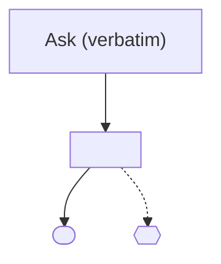

# Concept Map Template

Use the body below as the body of the `concept:map` issue, substituting every `<placeholder>`. The tracker is the only record: write no file and no frontmatter.

# Concept Map: <one-line destination statement>

## Ask (verbatim)
<The user's opening words, unedited. Written once at Chart, never reworded; Converge copies it into the brief.>

## Destination
<Define the concrete boundary of what this concept is aiming to accomplish. This fixes the scope of the discovery phase.>

- **Target brief status:** `ready-for-prd | exit-bug | exit-spike | dropped`
- **AFK drain:** `manual | authorized` *(user-set only; default `manual`)*

## Notes
<Domain context, relevant code areas, key resources, and lists of skills or experts to consult.>

### Established Facts & Candidate Vocabulary
<Current-system facts found by G2 lookups (each naming its file/probe source) and candidate `[[G-xxx]]` domain terms carried across sessions, including any ingested `/1b-concept-framing` handover state.>

## Decisions so far
<An index of confirmed decisions resolved during this concept map lifecycle. Full answers and resolutions live on the closed tickets themselves; pre-map `1b` handover decisions use `[1b handover]`.>

- [1b handover] <decision> — <gist> (why: <reason>) *(optional — omit if no `1b` handover)*
- [<ticket title>](<#/link>) — <gist of the decision>

## Not yet specified (fog)
<Enumerate the open, ambiguous areas that are not yet sharp enough to turn into precise decision tickets. As details become clear, graduate them into decision tickets and remove the graduated line here.>

## Out of scope
<Explicitly document decisions, features, or paths ruled out of scope for this concept to prevent scope creep.>

## Dependency Map

