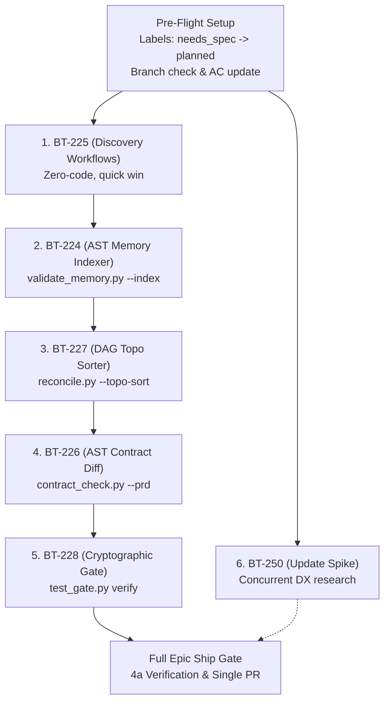

# Implementation Orchestration Plan: Epic BT-223
**Harden Lifecycle per 'Prompt Report' (arXiv:2406.06608)**

---

## 1. Executive Context & Governing Invariant

- **Epic:** BT-223 (`Harden lifecycle per 'Prompt Report' (0 constitution)`)
- **Type:** `improvement` | **Tier:** `epic` | **Tracker:** GitHub
- **Primary Source:** `docs/research/prompt-report-lifecycle-hardening.md`
- **Adversarial Critique:** `docs/research/prompt-report-adversarial-critique.md`
- **Systems Review:** Argon 4 High Systems Audit (`APPROVED WITH REVISIONS`, 2026-11-06)
- **Governing Invariant:**
  > **"Code governs state; scripts gate transitions; agents synthesize implementation."**
  > In StratOS, probabilistic prompt gymnastics are never substituted where deterministic Python standard libraries (`graphlib`, `re`, `ast`) or shell scripts solve the problem in $<5\text{ms}$ with zero token cost.

### Orchestration Architecture
A single **Main Orchestrator Agent** drives execution across all 6 child slices sequentially along the topological critical path. The Orchestrator delegates specialized, bounded exploration and audit responsibilities to read-only subagents while strictly retaining ownership of:
1. Version control, branching, and atomic git commits (AGENTS.md §4).
2. Human-In-The-Loop (HITL) communication, approvals, and question escalation.
3. State transitions and tracker updates (`gh issue edit`).
4. Deterministic test and build runner execution (running `pytest`, `build/build.py`, and `test_gate.py` directly at 0 model tokens).

```
┌──────────────────────────────────────────────────────────────────────────────┐
│                           MAIN ORCHESTRATOR AGENT                            │
│  • Single Git Writer (commits, branch tracking per AGENTS.md §4)             │
│  • HITL Dialog & Question Escalation to Human User                           │
│  • Deterministic Tool Execution (pytest, build.py, validate.py, test_gate)   │
└──────────────┬───────────────────────────────┬───────────────────────────────┘
               │                               │
               ▼                               ▼
    ┌──────────────────────┐        ┌──────────────────────┐
    │ Subagent A:          │        │ Subagent B:          │
    │ Plan Drafter & Seam  │───────▶│ Independent Plan     │
    │ Explorer (Phase 0.5) │        │ Auditor (Argon Gate) │
    │ (Read-only, .tmp/)   │        │ (VERDICT: PASS/REVISE│
    └──────────────────────┘        └──────────────────────┘
               │                               │
               └───────────────┬───────────────┘
                               │ (on PASS)
                               ▼
                    ┌──────────────────────┐
                    │ Implementer Coder:   │
                    │ Micro-TDD Loop       │
                    │ (RED -> GREEN -> REF)│
                    └──────────────────────┘
```

---

## 2. Pre-Flight Setup: Tracker State & Unit Branching

Before launching Slice 1 (BT-225), the Orchestrator executes pre-flight administrative reconciliation:

1. **Tracker Status Transitions:**
   - Transition build slices BT-224, BT-225, BT-226, BT-227, BT-228 from `status:needs_spec` to `status:planned` via:
     `gh issue edit <id> --remove-label "status:needs_spec" --add-label "status:planned"`
   - Leave BT-250 as a Research Spike (`status:planned` or `status:needs_spec` with Template A spike annotation).
   - Inject the Phase 0.5 Independent Plan Review acceptance criterion into each child issue.
2. **Milestone Handling (`[[L-003]]`):**
   - Stratosphere-OS framework does not use GitHub milestones (consumer project construct; `[[L-003]]`).
   - Slices of one epic ship in one PR on the single unit branch: `<type>/BT-<parentPadded>-<slug>`.
3. **Canonical Branch Isolation (AGENTS.md §4):**
   - Epic unit branch: `improvement/BT-0223-harden-lifecycle-prompt-report` (or existing active branch `improvement/BT-223-harden-lifecycle-per-prompt-report-0-con`).
   - All slices commit locally onto this single branch. Branch push occurs strictly at the 4a ship gate behind HITL user authorization.

---

## 3. Streamlined 3-Agent + Deterministic Gate Protocol

For every slice $S_i \in \{\text{BT-225}, \text{BT-224}, \text{BT-227}, \text{BT-226}, \text{BT-228}, \text{BT-250}\}$, the Orchestrator enforces this token-efficient lifecycle:

### Step 1: Context Intake & Scratch Plan Drafting (Subagent A — Plan Drafter)
- **Role:** `Plan Drafter` | **Type:** `research` (Read-only)
- **Task:** Inspect the slice ACs, related source files, existing tests, and the Prompt Report research document.
- **Deliverable:** Write `.tmp/3d-plan-BT-<padded>.md` containing:
  1. Files `[NEW]` and `[MODIFY]` with one-line intent.
  2. Integration seams to test and test fixture strategy.
  3. Strict 1:1 mapping from each Acceptance Criteria to planned test function names.
  4. Specific CLI flags, schemas, regex patterns, or prompt changes.
  5. Negative invariants and Prompt Report rejections preserved.

### Step 2: Adversarial Plan Review Gate (Subagent B — Argon Systems Auditor)
- **Role:** `Argon Systems Auditor` | **Type:** `research` (Read-only)
- **Task:** Independent review of `.tmp/3d-plan-BT-<padded>.md` against:
  - Acceptance Criteria in `gh issue view <n>`
  - Principles in `docs/research/prompt-report-lifecycle-hardening.md`
  - Negative invariants in `.memory/ARCHITECTURE.md`
- **Deliverable:** Write `.tmp/3d-plan-BT-<padded>-review.md`.
- **Hard Gate:**
  - `VERDICT: PASS` $\to$ Orchestrator advances to Step 3.
  - `VERDICT: REVISE` $\to$ Orchestrator resolves blockers in the plan before coding begins.

### Step 3: Test-Driven Implementation (Implementer Coder)
- **Role:** `TDD Implementer` | **Type:** `self` or inline orchestrator
- **Protocol:** `micro-tdd` (AGENTS.md §8: single writer for code).
  1. **RED:** Author failing tests matching the planned test names. Verify deterministic failure (`exit code != 0`).
  2. **GREEN:** Write the minimal code or surgical workflow prompt edits to satisfy tests. Verify green (`exit code == 0`).
  3. **REFACTOR:** Run `code-simplifier` and lint checks without changing behavior.
  4. **Canonical Gated Reflexion Protocol (`micro-tdd` §4):**
     - **Attempt 1 (Normal RED):** Silent execution. Zero conversational narration.
     - **Attempt 2 (Failed GREEN):** Gated Diagnostic Reflexion (Premise Check: formulate falsifiable hypothesis, check mocks/types before attempt 3).
     - **Attempt 3 (Failed GREEN):** Stuck Protocol Freeze (freeze diffs, prepare 2 architectural options, halt for HITL).

### Step 4: Deterministic Orchestrator Verification Gate (0 Model Tokens)
- **Executed Directly by Main Orchestrator (No LLM subagent):**
  1. Compile distribution skills: `python build/build.py`
  2. Validate framework bundle: `python build/validate.py`
  3. Execute unit/regression tests: `pytest <target_test_file>`
  4. Cryptographic record: `python .agents/scripts/test_gate.py record --suite <suite>`
  5. Atomic git commit: `<type>(BT-<slicePadded>): <summary>`

---

## 4. HITL Question Escalation Contract

If Subagent A or B encounters an architectural ambiguity, missing contract, or breaking trade-off:
1. The subagent halts and emits a structured message payload to the Orchestrator via `send_message`:
   ```json
   {
     "type": "HITL_DECISION_REQUIRED",
     "slice": "BT-xxx",
     "decision": "<one-sentence framing of the decision>",
     "options": [
       {"id": "A", "description": "<option A>", "tradeoff": "<tradeoff A>"},
       {"id": "B", "description": "<option B>", "tradeoff": "<tradeoff B>"}
     ],
     "recommended": "A"
   }
   ```
2. The Orchestrator halts subagent sequencing, presents the decision options to the human user in chat, and injects the user's explicit selection into the scratch plan before proceeding.

---

## 5. Detailed Slice Runbooks

### Runbook 1: BT-225 — Stage 1 (Discovery Workflows)
- **Priority:** 1 (Quick win, unblocks untrusted data safety, zero Python risk)
- **Target Files:**
  - `src/workflows/1a-research.md`
  - `src/workflows/1b-concept-framing.md`
  - `src/workflows/1c-concept-map.md`
  - `src/references/concept-map-template.md`
- **Orchestration Flow:**
  1. *Subagent A (Plan Drafter):* Draft `.tmp/3d-plan-BT-225.md` (XML delimiters `<external_untrusted_source>` in 1a, 10–15 question frontier budget in 1b, single-pass Mermaid `flowchart TD` in 1c).
  2. *Subagent B (Auditor):* Review plan $\to$ `.tmp/3d-plan-BT-225-review.md`.
  3. *Implementer:* Apply edits to `src/workflows/` and template.
  4. *Deterministic Gate:* Run `python build/build.py && python build/validate.py`.
  5. *Commit:* `improvement(BT-225): untrusted research ingestion pipe and dependency-ordered framing`

---

### Runbook 2: BT-224 — Stage 0 (Session AST Memory Hydration)
- **Priority:** 2 (Core hydration foundation for subsequent stages)
- **Target Files:**
  - `src/scripts/validate_memory.py`
  - `src/skills/load-memory/SKILL.md`
  - `src/workflows/0a-start-session.md`
  - `src/workflows/0b-stop-session.md`
  - `src/workflows/0d-nightly-consolidation.md`
  - `src/workflows/0e-plain-english.md`
  - `tests/framework/test_validate_memory_index.py` (NEW)
- **Orchestration Flow:**
  1. *Subagent A (Plan Drafter):* Draft `.tmp/3d-plan-BT-224.md` (`validate_memory.py --index --query-issue <id>`, `.tmp/active-memory-refs.txt` output, `<5ms` target, zero model turns).
  2. *Subagent B (Auditor):* Verify negative constraint extraction (`[LAW]`, `Avoid:`).
  3. *Implementer:*
     - Author `tests/framework/test_validate_memory_index.py` (RED).
     - Implement `--index` in `src/scripts/validate_memory.py` (GREEN).
     - Update `load-memory/SKILL.md` and `0a`–`0e` workflows.
  4. *Deterministic Gate:* `python build/build.py && python build/validate.py && pytest tests/framework/test_validate_memory_index.py`.
  5. *Commit:* `improvement(BT-224): deterministic ast memory hydration and consolidation`

---

### Runbook 3: BT-227 — Stage 3 (Topological DAG Sorter & Gated Reflexion)
- **Priority:** 3 (Mathematical planning and implementation quietness)
- **Target Files:**
  - `src/scripts/reconcile.py`
  - `src/workflows/3a-version-planning.md`
  - `src/workflows/3b-create-issue.md`
  - `src/workflows/3c-sprint-planning.md`
  - `src/workflows/3d-implement-issue.md`
  - `src/skills/micro-tdd/SKILL.md`
  - `src/workflows/3z-afk-loop.md`
  - `tests/workflows/test_reconcile_topo.py` (NEW)
- **Orchestration Flow:**
  1. *Subagent A (Plan Drafter):* Draft `.tmp/3d-plan-BT-227.md` (`graphlib.TopologicalSorter` integration into `reconcile.py --topo-sort`, cycle error `[CYCLE-DETECTED ...]` format, Gated Reflexion trigger specification).
  2. *Subagent B (Auditor):* Audit cycle edge cases (disconnected, diamond, self-loops).
  3. *Implementer:*
     - Author `tests/workflows/test_reconcile_topo.py` (RED).
     - Implement `--topo-sort` in `src/scripts/reconcile.py` (GREEN).
     - Update `3a`–`3d`, `micro-tdd`, `3z`.
  4. *Deterministic Gate:* `python build/build.py && python build/validate.py && pytest tests/workflows/test_reconcile_topo.py`.
  5. *Commit:* `improvement(BT-227): topological dag sorter and gated diagnostic reflexion`

---

### Runbook 4: BT-226 — Stage 2 (Two-Stage Macro-CoT & AST Contract Diffing)
- **Priority:** 4 (Design & specification hardening)
- **Target Files:**
  - `src/scripts/contract_check.py`
  - `src/workflows/2a-write-prd.md`
  - `src/workflows/2b-interface-design.md`
  - `src/workflows/2c-reconcile-specs.md`
  - `src/workflows/2z-write-spec.md`
  - `tests/scripts/test_contract_check_ast.py` (NEW)
- **Orchestration Flow:**
  1. *Subagent A (Plan Drafter):* Draft `.tmp/3d-plan-BT-226.md` (`contract_check.py --prd <file> --ts <file|dir> --schema <file>`, zero-dependency Python parser for TS interfaces and PRD endpoints, Two-Stage Macro-CoT in `2a`).
  2. *Subagent B (Auditor):* Audit TS interface parser grammar (generics, optional fields, union types).
  3. *Implementer:*
     - Author tests in `tests/scripts/test_contract_check_ast.py` (RED).
     - Extend `src/scripts/contract_check.py` (GREEN).
     - Update `2a`, `2b`, `2c`, `2z`.
  4. *Deterministic Gate:* `python build/build.py && python build/validate.py && pytest tests/scripts/test_contract_check_ast.py`.
  5. *Commit:* `improvement(BT-226): two-stage macro-cot prd drafting and ast contract diffing`

---

### Runbook 5: BT-228 — Stage 4 (Cryptographic Test Gating & Decomposed Audits)
- **Priority:** 5 (Verification & audit hardening)
- **Target Files:**
  - `src/scripts/test_gate.py`
  - `src/workflows/4a-verify-and-ship.md`
  - `src/workflows/4b-audit-architecture-drift.md`
  - `src/workflows/4c-codebase-health-audit.md`
  - `tests/scripts/test_test_gate_committed.py` (NEW)
- **Orchestration Flow:**
  1. *Subagent A (Plan Drafter):* Draft `.tmp/3d-plan-BT-228.md` (`test_gate.py verify --base <base>` on clean trees, decoupling 4a checklist from line numbers, `4c` 4 orthogonal passes).
  2. *Subagent B (Auditor):* Verify git blob hashing consistency across branch checkouts.
  3. *Implementer:*
     - Author test cases in `tests/scripts/test_test_gate_committed.py` (RED).
     - Extend `src/scripts/test_gate.py` and update `4a`–`4c` (GREEN).
  4. *Deterministic Gate:* `python build/build.py && python build/validate.py && pytest tests/scripts/test_test_gate_committed.py`.
  5. *Commit:* `improvement(BT-228): cryptographic test gating and decomposed audit passes`

---

### Runbook 6: BT-250 — Stage 0 (Update Flow Profiling Spike)
- **Priority:** 6 (Independent DX investigation)
- **Deliverable File:** `docs/research/host-skill-cache-invalidation.md`
- **Orchestration Flow:**
  1. *Subagent A (Profiling Researcher):* Profile Antigravity IDE and Claude Code skill discovery, caching, and hot-reload hooks across the 3 modification scenarios.
  2. *Subagent B (Auditor):* Evaluate the feasibility of zero-restart update mechanisms.
  3. *Main Orchestrator:* Review deliverable, commit report, mark BT-250 done (`status:done`).
  4. *Scope Boundary:* Any follow-up Build slices must be created under **Epic #242 (v5.1 follow-ups)** via `gh issue create --parent 242`, preserving the closed boundary of BT-223.
  5. *Commit:* `docs(BT-250): research - host skill cache invalidation and hot reloading`

---

## 6. Execution Dependency Graph & Critical Path



---

## 7. Risk Matrix & Recovery Protocols

| Risk / Failure Mode | Detection Point | Automatic Recovery Protocol |
|:---|:---|:---|
| **Subagent Plan Rejection** | Subagent B emits `VERDICT: REVISE` | Orchestrator edits plan to address specific bulleted blockers. If ambiguous, triggers HITL escalation. |
| **Python Parser Overhead** | Benchmarking in `BT-224` or `BT-227` exceeds 5ms | Strip full file AST parses; fall back to compiled line-by-line regex tokenizers (`re.compile`). |
| **Stuck Implementer** | GREEN test fails on Attempt 2 | Trigger Gated Diagnostic Reflexion (falsifiable hypothesis / premise check). If Attempt 3 fails, freeze diffs and halt for HITL. |
| **Distribution Stale** | `python build/validate.py` fails | Re-run `python build/build.py` to compile workflows into `dist/skills/` and re-validate. |
