# BT-242 (`#242`) v5.1 Follow-Ups — Execution & Orchestration Plan (v0.2 — Challenged & Revised)

> **Status:** v0.2 (Revised after independent adversarial review by `flash` challenger subagent `f5675cb4`; all 7 `[MUST FIX]`, 2 `[SHOULD FIX]`, and 2 `[NIT]` findings resolved — see §5).

---

## 1. Locked Owner Decisions (D1–D4, Updated After Challenge)

| ID | Slice | Decision Locked |
|:---|:---|:---|
| **D1** | **S1 (`#243`) & S10 (`#257`)** | **Branch-aware local commit in `0d`:** When on the default branch (`main`/`master`), after Phase 4 user approval and rewriting `## Decisions` stub lines, `0d` commits only its explicit touched paths (`docs/nightly/`, rebuilt `index.md` files, and approved `.memory/` Quick fixes) locally as `chore(nightly): consolidate <YYYY-MM-DD>` (never pushes automatically) and appends `<sha>` to `accepted · applied <sha>`. When on a feature branch, `0d` leaves changes uncommitted (protecting `test_gate.py` suite records and slice PR diffs) and writes `accepted · applied` without `<sha>`. Also note `0d` alongside `2a`/`2b`/`3a` in `AGENTS.md` §4 Documentation-artifact exception (**N-2**). |
| **D2** | **S2 (`#244`)** | 1. Split `src/scripts/tracker_switch.py` (`gh` sync vs. local rewrite) and extract shared helpers from `src/scripts/reconcile.py` (709 → ≤400 lines) into existing **`src/scripts/_tracker_common.py`** (currently 144 lines, already mapped in `scaffold.py:634` and `verify_scripts.py:211` — **MF-2, SF-2**). 2. **No `## Floor exceptions` edits on the branch (`MF-1`):** `floor_guard.py:189` rejects any new `## Floor exceptions` row not already on `main` (`[exception-added]`) and does not check line counts (`A-003` is advisory in 4a Standards). Leave `scaffold.py` and `.memory/ARCHITECTURE.md` untouched on the branch; record the owner's `A-003` waiver for legacy `scaffold.py` in the `#244` commit/PR notes. 3. Record the v4 `BACKLOG_MAP.md` ICE-column autofix item as superseded by v5.0.0, and fix `apply_autofix` in `validate_memory.py` (RED test first) so `--autofix` never appends illegal `Refs:` to `GLOSSARY.md` entries. |
| **D3** | **S5 (`#247`)** | **a) Scope locked:** Do **not** expand `#247` to convert other multi-cited references into Layer 3 skills; keep all 18 other multi-cited files in `src/references/` as on-demand references (0 system-prompt token overhead). **b) Status-Quo Equivalence Test First:** Before switching workflows or `build/build.py` from `tracker-verbs-*.md` to `src/scripts/tracker.py`, build and pass a dual-runner characterization/equivalence test suite (`tests/scripts/test_tracker_equivalence.py`) proving identical state, stdout, and exit codes against `gh_shim.py` (`tracker: github`) and `issues.py` (`tracker: local`). **c) Setup/Update & Test Alignment:** Wire `tracker.py` into `scaffold.py`, `verify_scripts.py`, L3 `SCRIPTS`, and migrate `tests/framework/test_tracker_verbs.py`, `test_contract_s6.py`, and `test_scoped_readers.py` in-place while keeping net assertions ≥ 0 (`floor_guard.py` `[tests-removed]` — **MF-6**). **d) Execution Mode:** Run `#247` in a **parallel HITL session** using a two-phase split (Phase 5A standalone script + equivalence tests in parallel; Phase 5B workflow cutover after Wave 1/2). |
| **D4** | **S7 (`#233`)** | **Executed + Ship Unlink Rule (`MF-5`):** `#233` is updated to v5.0.0 (`status:planned`, `scope:deferred`, `Parent: BT-242`). Because `4a` Step 8 (`Epic Check`) and Step 9 (`Draft rule`) hold an epic PR in draft while *any* sub-issue is open (with no `scope:deferred` exemption), `#233` stays under `#242` while parked during Waves 1–3; at Wave 4 final ship, if `#233` is still parked (not built in this PR), either implement it or unlink its `subIssue` edge from `#242` (`removeSubIssue`) before the final `4a` ready flip so `#242` can close cleanly. |

---

## 2. D3(b) & D3(c): Deep Dive for Slice S5 (`#247` — `tracker.py`)

### 2.1 D3(b) — Status-Quo Equivalence Test Design (`tests/scripts/test_tracker_equivalence.py`)
Before touching any workflow or `build/build.py`, `test_tracker_equivalence.py` must pass 100% green across three layers:

1. **Layer 1: Dual-Backend State & Output Equivalence (18 Verbs + 8 Reads)**
   - **GitHub Backend (`tracker: github` against `gh_shim.py`):**
     - Initialize two identical `GH_SHIM_STORE` JSON stores (`store_legacy.json`, `store_cli.json`).
     - Execute every verb from `tracker-verbs-github.md` (`create`, `set_status`, `set_labels`, `ensure_label`, `set_milestone`, `ensure_milestone`, `close_milestone`, `set_parent`, `add_blocker`, `clear_blocker`, `close`, `reopen`, `comment`, `set_refs`, `set_body`, `claim`) and every read (`get`, `list`, `wip`, `resume_note`, `candidates`, `children`, `blockers`) once using the raw status-quo `gh` commands against `store_legacy.json`, and once using `python src/scripts/tracker.py <verb> ...` against `store_cli.json`.
     - **Assertions:**
       - `json.loads(store_legacy) == json.loads(store_cli)` after each mutation (identical issue numbers, labels, Single Status Invariant, milestones, sub-issue edges, blockedBy edges, comments, assignees, state, and `stateReason`).
       - Read outputs (`get`, `list`, `wip`, `resume_note`, `candidates`, `children`, `blockers`) return identical parsed JSON / line output and exit codes.
   - **Local Backend (`tracker: local` against `<repo>/issues` branch):**
     - Initialize two identical git repositories (`repo_legacy`, `repo_cli`) with `tracker: local` and `tracker_branch: proj/issues`.
     - Execute the same verb and read sequence via `python src/scripts/issues.py ...` on `repo_legacy` and `python src/scripts/tracker.py ...` on `repo_cli`.
     - **Assertions:**
       - Identical stdout and exit codes on every call.
       - Identical file tree and markdown contents on `refs/heads/proj/issues` (`git diff` between the two stores is empty).
2. **Layer 2: Failure, Retry & Invariant Parity**
   - **Retry + Halt Contract (`[[A-005]]`):** Simulate a failing `gh` call (`GH_SHIM_FAIL=1`); assert `tracker.py` retries 3 times with backoff, exits non-zero, and writes **zero** local fallback files.
   - **Single Status Invariant:** Assert `tracker.py set-status <id> "in progress"` removes any existing `status:*` label before adding `status:in progress`.
   - **Backend Resolution Parity:** Assert `tracker.py` resolves `tracker: github | local` using `reconcile.read_tracker(".memory/ARCHITECTURE.md")` so backend detection is 100% identical to `reconcile.py` and `ice_read.py`.
3. **Layer 3: Downstream Gate Compatibility**
   - Verify `reconcile.py --ids ... --expect ... --with-edges ...` and `ice_read.py candidates` pass unchanged against state mutated by `tracker.py`.

### 2.2 D3(c) — 7 Implications of `tracker.py` on Setup, Update & Crosscheck Gates

| # | Surface | Exact Implication | Required Action in S5 (`#247`) |
|:---|:---|:---|:---|
| **1** | **Project Script Scaffolding (`src/scripts/scaffold.py`)** | `scaffold.py:634` (`get_bundled_project_scripts`) hardcodes the tuple of scripts copied from `<plugin>/scripts/` into `<project>/.agents/scripts/`. | Add `"tracker.py"` to `get_bundled_project_scripts` in `src/scripts/scaffold.py:634`. |
| **2** | **Script Mapping Gate (`tests/runners/verify_scripts.py`)** | `verify_scripts.py:203-241` verifies that every file bundled into `dist/skills/stratosphere-setup/scripts/` maps to a `.agents/scripts/<name>` destination. Any unmapped file fails `bash scripts/check.sh`. | Add `elif rel_str == "scripts/tracker.py": proj_rel_path = ".agents/scripts/tracker.py"` in `tests/runners/verify_scripts.py`. |
| **3** | **Automatic Orphan Pruning on Consumer Update (`scaffold.py --update`)** | When `build/build.py` stops copying `tracker-verbs-github.md`, `tracker-verbs-local.md`, and `github-issue-relations.md` into the 14 skills, `dist/skills/stratosphere-setup/versions.json` drops those 42 `skills/<name>/references/...` keys. On `/stratosphere-update`, `scaffold.py:1153-1205` automatically detects those 42 paths in `.agents/.stratosphere-lock.json` as `pruned_orphans` and deletes both `.agents/skills/*/references/...` and `.claude/skills/*/references/...` twins. | **Zero manual migration code needed** — `scaffold.py` orphan pruning cleans consumer projects automatically. Add a pin in `test_update_flow.py`. |
| **4** | **Suite Integrity Check (`src/scripts/check_suite.py`)** | `check_suite.py suite` checks `LIFECYCLE_SKILLS` (24) + `EXECUTION_SKILLS` (4) and verifies only references matched by `REF_CITE` in each `SKILL.md`. Because `tracker.py` is a script (not a 5th execution skill), the total skill count stays at **28 skills**, and uncited `tracker-verbs-*.md` are no longer required by `check_suite.py suite`. | Keep `tracker.py` in `src/scripts/` (do not add a skill folder). |
| **5** | **Bootstrap Ordering inside `stratosphere-setup` & `stratosphere-update`** | In `stratosphere-setup`, Checkpoint 6 runs *after* `scaffold.py` has placed `.agents/scripts/`. In `stratosphere-update`, Phase 0.5–3 run *before* Phase 4 (`scaffold.py --update`) copies new scripts into `<project>/.agents/scripts/`, and Phase 4 step 5 calls `issues.py migrate` directly. | In `stratosphere-setup/SKILL.md`, pre-Checkpoint-6 script calls use `<plugin>/scripts/...`; post-Checkpoint-6 calls use `.agents/scripts/tracker.py`. |
| **6** | **L3 Lifecycle Harness Sandbox Seeding (`tests/lifecycle/`)** | `tests/lifecycle/test_l3_seed.py:56` and `test_l3_assertions.py:287` copy a fixed `SCRIPTS` tuple into the L3 test sandbox. | Add `"tracker.py"` to `SCRIPTS` in `test_l3_seed.py` and `test_l3_assertions.py`. |
| **7** | **Existing Crosscheck Tests & `floor_guard.py` Assertion Count (`MF-6`)** | `tests/framework/test_tracker_verbs.py` (~30 assertions), `test_contract_s6.py:51,74,77`, and `test_scoped_readers.py:32,73` assert `"references/tracker-verbs-github.md"` and `build.generate_projected_verbs`. Deleting assertions causes `floor_guard.py:161` to fail with `[tests-removed]` (`sum(a - r) < 0`). | In Phase 5B, update assertions in-place in `test_tracker_verbs.py`, `test_contract_s6.py`, and `test_scoped_readers.py` to assert `.agents/scripts/tracker.py` and keep total assertion count `sum(a - r) >= 0`. |

---

## 3. Orchestration Decision: Why Hybrid `/3d` + Wave-Gated `/4a` Beats Monolithic `/3z`

| Criterion | Monolithic `/3z-afk-loop` across 8 slices | Hybrid Orchestrator + `flash` Subagents (`/3d` per slice + Wave `/4a`) [CHOSEN] |
|:---|:---|:---|
| **Subagent Model** | Fixed by `3z` defaults (`inherit` for Implementer & Spec Auditor, `flash` only for Standards). | **All implementation & audit subagents run on `Model: "flash"`** (3.8 Flash High in Antigravity), with the main session (`Gemini 4 Argon High`) acting as Orchestrator, Git Single-Writer, and Final Verifier. |
| **Test Execution Cost** | Runs full test suite + `ship-only` per slice (8× full suite runs = ~45 mins of Windows subprocess stalls). | Subagents run **only targeted tests** (`pytest <touched_file.py>`, ~2–5s each). Orchestrator records each commit via `test_gate.py record -- pytest <target>` (**MF-3**). Full suite (`check.sh`) runs **once** before Wave 4 `ship-only` loop. |
| **`dist/` & Git Collisions** | Each slice rebuilds `dist/` (`versions.json` touches all 28 skills), preventing parallel work. | Subagents edit **only `src/` and `tests/` on disjoint file clusters** (no `build.py`, no `git commit`). Orchestrator runs `python build/build.py`, `floor_guard.py`, and commits sequentially per slice (`<type>(BT-<n>): 
`). |
| **Audit Quality (`4a`)** | 16 separate auditor dispatches (2 per slice). | Independent `flash` Spec Auditor + Standards Auditor dispatched per wave (`4a audit-only`), followed by sequential `4a ship-only` per slice in Wave 4 (**MF-4**). |

---

## 4. Parallel Execution Waves & File-Isolation Matrix

### Step 0: Worktree & Branch Bootstrap (`MF-7`)
Before Wave 1 starts:
1. **Worktree Environment Alignment (`MF-7`):** If executing inside the `bt242_spec_review` worktree (where gitignored `.agents/` and `.memory/` are absent), create junctions/links to the primary checkout (`cmd /c mklink /J .agents c:\Users\patri\Dev\Stratosphere-OS\.agents` and copy/link `.memory/` from `c:\Users\patri\Dev\Stratosphere-OS\.memory`), or execute from `c:\Users\patri\Dev\Stratosphere-OS`.
2. **Branch Creation (`3d` Step 1 + `[[L-003]]`):** Create and switch to `improvement/BT-242-v5-1-follow-ups` from `main` (`3eff7ba`).
3. **Status Activation:** Transition `#242` (and the active Wave 1 slices) to `status:in progress`.

### Parallel Track (Separate HITL Session / Worktree): Slice S5 (`#247`)
- **Phase 5A (Run Immediately in Parallel with Waves 1–3 — Zero File Overlap):**
  - **Files touched:** `src/scripts/tracker.py` (new) and `tests/scripts/test_tracker_equivalence.py` (new).
  - **Work:** Build and pass the 3-layer Equivalence Test Suite (§2.1) against `gh_shim.py` and `issues.py`, then implement `src/scripts/tracker.py` until 100% green.
- **Phase 5B (Run in Wave 4 After Waves 1–3 Land on `improvement/BT-242-v5-1-follow-ups`):**
  - **Files touched:** `build/build.py`, `src/scripts/scaffold.py`, `tests/runners/verify_scripts.py`, `tests/lifecycle/test_l3_seed.py`, `tests/lifecycle/test_l3_assertions.py`, `tests/framework/test_tracker_verbs.py`, `tests/framework/test_contract_s6.py`, `tests/framework/test_scoped_readers.py`, and the 14 citing workflows/commands.

### Main Session Track (Orchestrator + `flash` Subagents)

```mermaid
flowchart TD
    B0["Step 0: Bootstrap .agents/.memory in worktree (MF-7)<br/>Create branch improvement/BT-242-v5-1-follow-ups"]
    
    subgraph W1["Wave 1: Parallel Disjoint Subagents (AFK Slices)"]
        S10["Subagent 1A (flash): S10 (#257)<br/>src/constitution/AGENTS.md, AGENTS.md, pytest.ini,<br/>auditor-model-tiers.md (incl. N-1, N-2)"]
        S8["Subagent 1B (flash): S8 (#251)<br/>src/workflows/0b-stop-session.md"]
        S3["Subagent 1C (flash): S3 (#245)<br/>tests/lifecycle-harness/shims/gh_shim.py,<br/>tests/lifecycle/test_l3_gh_shim.py"]
    end
    
    C1["Orchestrator Gate 1 (MF-3):<br/>build.py + floor_guard.py + test_gate.py record -- pytest<br/>3 atomic commits: BT-257, BT-251, BT-245"]
    
    subgraph W2["Wave 2: Parallel Disjoint Subagents (AFK Slices)"]
        S1["Subagent 2A (flash): S1 (#243)<br/>0d (incl. D1), 4a, 3z, pr-body-and-ship.md,<br/>test_scoped_ship_loop.py"]
        S2["Subagent 2B (flash): S2 (#244)<br/>reconcile.py, _tracker_common.py, tracker_switch.py,<br/>validate_memory.py (MF-1, MF-2, SF-2)"]
    end
    
    C2["Orchestrator Gate 2 (MF-3):<br/>build.py + floor_guard.py + test_gate.py record -- pytest<br/>2 atomic commits: BT-243, BT-244<br/>Wave 1+2 4a audit-only (flash Spec + Standards)"]
    
    subgraph W3["Wave 3: Update Flow Slice (HITL)"]
        S9["Subagent 3A (flash): S9 (#252)<br/>stratosphere-update/SKILL.md, update-*.md,<br/>check_suite.py, test_check_suite.py"]
    end
    
    C3["Orchestrator Gate 3 (MF-3):<br/>build.py + floor_guard.py + test_gate.py record -- pytest<br/>Commit BT-252 + Wave 3 4a audit-only"]
    
    S5B["Wave 4A: Integrate Parallel S5 (#247) Phase 5B (MF-6)<br/>Commit BT-247 + test_gate.py record --suite (check.sh)"]
    SHIP1["Wave 4B: Sequential 4a ship-only per code slice (MF-4)<br/>BT-257 -> BT-251 -> BT-245 -> BT-243 -> BT-244 -> BT-252 -> BT-247<br/>(Opens/updates draft PR #N)"]
    S4["Wave 4C: S4 (#246, HITL) Live Host Verification Round (SF-1)<br/>Close #246 by comment + Unlink/resolve parked #233 (MF-5)<br/>Final 4a Epic Check + FAA + gh pr ready"]

    B0 --> W1 --> C1 --> W2 --> C2 --> W3 --> C3 --> S5B --> SHIP1 --> S4
```

### Detailed Wave Specifications

#### Wave 1 — 3 Parallel `flash` Subagents (100% Disjoint Files)
| Subagent | Slice | Target Files (Exclusive Ownership) | Targeted Verification Command |
|:---|:---|:---|:---|
| **1A (`flash`)** | **S10 (`#257`)** | `src/constitution/AGENTS.md`, `AGENTS.md` (**N-1**, plus `0d` in §4 **N-2**), `pytest.ini`, `src/references/auditor-model-tiers.md`, `docs/research/targeted-verification-and-subagent-dispatch-scoping.md` (copied from `fix_subagent_model_enum` worktree) | `python -m pytest tests/framework/test_no_vendor_model_ids.py tests/framework/test_host_hygiene.py` |
| **1B (`flash`)** | **S8 (`#251`)** | `src/workflows/0b-stop-session.md`, `tests/framework/test_validate_memory_index.py` | `python -m pytest tests/framework/test_validate_memory_index.py` |
| **1C (`flash`)** | **S3 (`#245`)** | `tests/lifecycle-harness/shims/gh_shim.py`, `tests/lifecycle/test_l3_gh_shim.py` | `python -m pytest tests/lifecycle/test_l3_gh_shim.py` |

- **Orchestrator Gate 1 (`MF-3`):**
  For each slice (`BT-257`, `BT-251`, `BT-245`):
  1. Run `python build/build.py` (when `src/` changed) and `python .agents/scripts/floor_guard.py`.
  2. Stage only that slice's files, run `python .agents/scripts/test_gate.py record -- python -m pytest <slice_tests>`, and commit `<type>(BT-<padded>): 
`.

#### Wave 2 — 2 Parallel `flash` Subagents (Disjoint Workflow vs. Script Clusters)
| Subagent | Slice | Target Files (Exclusive Ownership) | Targeted Verification Command |
|:---|:---|:---|:---|
| **2A (`flash`)** | **S1 (`#243`)** | `src/workflows/0d-nightly-consolidation.md` (with **D1**), `src/workflows/4a-verify-and-ship.md` (incl. `-m integration` checklist line from `#244`), `src/workflows/3z-afk-loop.md`, `src/references/pr-body-and-ship.md`, `tests/framework/test_scoped_ship_loop.py` | `python -m pytest tests/framework/test_scoped_ship_loop.py tests/framework/test_validate_memory_index.py` |
| **2B (`flash`)** | **S2 (`#244`)** | `src/scripts/reconcile.py`, `src/scripts/_tracker_common.py` (absorbs extracted helpers — **MF-2, SF-2**), `src/scripts/tracker_switch.py`, `src/scripts/validate_memory.py`, `tests/scripts/test_tracker_switch.py`, `tests/workflows/test_reconcile.py`, `tests/scripts/test_validate_memory.py` | `python -m pytest tests/scripts/test_tracker_switch.py tests/workflows/test_reconcile.py tests/scripts/test_validate_memory.py` |

- **Orchestrator Gate 2 (`MF-3`):**
  1. Run `python build/build.py` and `python .agents/scripts/floor_guard.py` (confirm net assertions ≥ 0 and 0 floor violations).
  2. Stage, record via `python .agents/scripts/test_gate.py record -- python -m pytest <slice_tests>`, and commit `improvement(BT-243): ...` and `maintenance(BT-244): ...`.
  3. Dispatch two independent `flash` subagents (`4a audit-only`: Spec Auditor + Standards Auditor) over the Wave 1–2 commits.

#### Wave 3 — 1 `flash` Subagent (`S9 #252`, `mode:HITL`)
| Subagent | Slice | Target Files | Targeted Verification Command |
|:---|:---|:---|:---|
| **3A (`flash`)** | **S9 (`#252`)** | `src/commands/stratosphere-update/SKILL.md` (keep ≤ 13,500 chars), `src/references/update-antigravity-plugin.md`, `src/references/update-claude-marketplace.md`, `src/references/update-copied-skills.md`, `src/scripts/check_suite.py`, `tests/scripts/test_check_suite.py`, `tests/framework/test_update_skill_split.py`, `tests/framework/test_plugin_bundle.py` | `python -m pytest tests/scripts/test_check_suite.py tests/framework/test_update_skill_split.py tests/framework/test_plugin_bundle.py` |

- **Orchestrator Gate 3:** Review diff with user (HITL), run `python build/build.py` + `floor_guard.py`, record via `test_gate.py record -- python -m pytest ...`, commit `improvement(BT-252): ...`, and run `4a audit-only` delta check.

#### Wave 4 — Integrate `S5 (#247)` + Per-Slice `4a ship-only` Loop (`MF-4`) + Live Verification (`S4 #246`, `SF-1`, `MF-5`)
1. **Wave 4A (Integrate `#247` Phase 5B):** Merge/apply `#247` Phase 5B onto `improvement/BT-242-v5-1-follow-ups` (including in-place test updates in `test_tracker_verbs.py`, `test_contract_s6.py`, `test_scoped_readers.py` per **MF-6**), run `python build/build.py` + `floor_guard.py`, commit `improvement(BT-247): ...`, and run `4a audit-only` delta check on `BT-247`.
2. **Full Suite Gate Record:** Run `python .agents/scripts/test_gate.py record --suite BT-247 -- bash scripts/check.sh` once at the final code HEAD (`pr_body.py suite` reuses this record for all 7 slices because `HEAD` does not move between `ship-only` calls!).
3. **Wave 4B (Sequential `4a ship-only` Pass Over All 7 Code Slices — `MF-4`):**
   - After user ship confirmation, run `4a ship-only` (Phase 5 steps 5–7, 9) for each slice in commit order:
     `BT-257` → `BT-251` → `BT-245` → `BT-243` → `BT-244` → `BT-252` → `BT-247`
   - Each pass updates `.tmp/4a-prior-body.md` → `gh pr create --draft` / `gh pr edit` (flipping that slice's row from `PENDING` to `PASS` and adding `Closes #<slice>.`), comments `"Shipped in PR #<pr> — <pr-url>"` on the slice issue, closes the slice with `status:done`, and verifies via `reconcile.py --pr-id BT-<slice>`.
   - Because `#246` (and parked `#233`) are still open sub-issues of `#242`, the PR remains **draft** after `BT-247` (`SF-1`).
4. **Wave 4C (`S4 #246` Live Host Verification & Epic Completion — `SF-1`, `MF-5`):**
   - Execute `S4 (#246, mode:HITL)` live verification items against the pushed branch/draft PR with owner approval per step; post the evidence comment on `#246` and close `#246` (`status:done`).
   - Handle parked `#233` (`MF-5`): either build `#233` now, or unlink `#233` from `#242` (`removeSubIssue`) so `#242` has 0 open sub-issues.
   - Re-run `4a ship-only` on `BT-247` to trigger Step 8 (`Epic Check` + `Feature Acceptance Audit` + `ci_gate.py` + `--close BT-242` + `gh pr ready`) and transition `#242` to `status:in review`.

---

## 5. Challenge Log & Resolutions (v0.1 → v0.2)

| ID | Severity | Challenger Finding | Resolution in v0.2 |
|:---|:---:|:---|:---|
| **MF-1** | MUST | `floor_guard.py:189` rejects any `## Floor exceptions` row added on a branch (`[exception-added]`) and does not check line counts. | Dropped `.memory/ARCHITECTURE.md` edits from D2 and Wave 2. `scaffold.py` is untouched in S2; `reconcile.py` drops ≤400 lines via helper extraction. |
| **MF-2** | MUST | Any new `.py` file under `src/scripts/` fails `verify_scripts.py:241` unless mapped in `scaffold.py:634` and `verify_scripts.py`. | S2 extracts helpers into existing `src/scripts/_tracker_common.py` (144 lines, already mapped). Zero new script files in S2. |
| **MF-3** | MUST | Pre-commit hook (`test_gate.py check`) blocks `git commit` if tests were run with bare `pytest` instead of `test_gate.py record`. | Added `python .agents/scripts/test_gate.py record -- python -m pytest <target>` to Orchestrator Gates 1, 2, and 3 before every commit. |
| **MF-4** | MUST | Running `4a` only once on `BT-247` leaves earlier slices as `PENDING` (no `Closes #<n>.`, unclosed on GitHub, fails `reconcile.py` & Epic Check). | Replaced single `4a` call in Wave 4 with the sequential `4a ship-only` loop across all 7 code slices (`BT-257`..`BT-247`), reusing one `--suite` record at final `HEAD`. |
| **MF-5** | MUST | `4a` Step 8 & Step 9 have no exemption for `scope:deferred`; open child `#233` blocks `#242` Epic Check and forces PR draft. | Added explicit Wave 4C gate: unlink parked `#233` from `#242` (`removeSubIssue`) before the final Epic Check / `gh pr ready` flip (unless `#233` is implemented in this PR). |
| **MF-6** | MUST | 30+ assertions in `test_tracker_verbs.py`, `test_contract_s6.py`, and `test_scoped_readers.py` pin `tracker-verbs-*.md`; deleting them fails `floor_guard.py` `[tests-removed]`. | Added Implication #7 in §2.2 and Wave 4A requirement: migrate assertions in-place to `tracker.py` keeping net assertion delta ≥ 0. |
| **MF-7** | MUST | Gitignored `.agents/` and `.memory/STATUS.md` are absent in the `bt242_spec_review` worktree, breaking `python .agents/scripts/...` calls. | Added Step 0 Worktree Bootstrap (junction `.agents` and sync `.memory/` from `c:\Users\patri\Dev\Stratosphere-OS\`). |
| **SF-1** | SHOULD | `S4 (#246)` is a child slice of `#242`; PR cannot go ready until `#246` is closed by comment. | Sequenced Wave 4B (`ship-only` to draft PR) → Wave 4C (`#246` live verification + close by comment → final `4a` ready flip). |
| **SF-2** | SHOULD | Concurrent edits to `scaffold.py` across S2, S9, and S5 would conflict. | S2 and S9 do not touch `scaffold.py`; only S5 Phase 5B touches `scaffold.py:634` in Wave 4A. |
| **N-1** | NIT | Both `src/constitution/AGENTS.md` and root `AGENTS.md` must stay in sync for S10 (`#257`). | Included both files in Subagent 1A's target list. |
| **N-2** | NIT | `AGENTS.md` §4 Documentation-artifact exception should list `0d` alongside `2a`, `2b`, `3a` per D1. | Included in Subagent 1A's `AGENTS.md` edit in Wave 1. |
