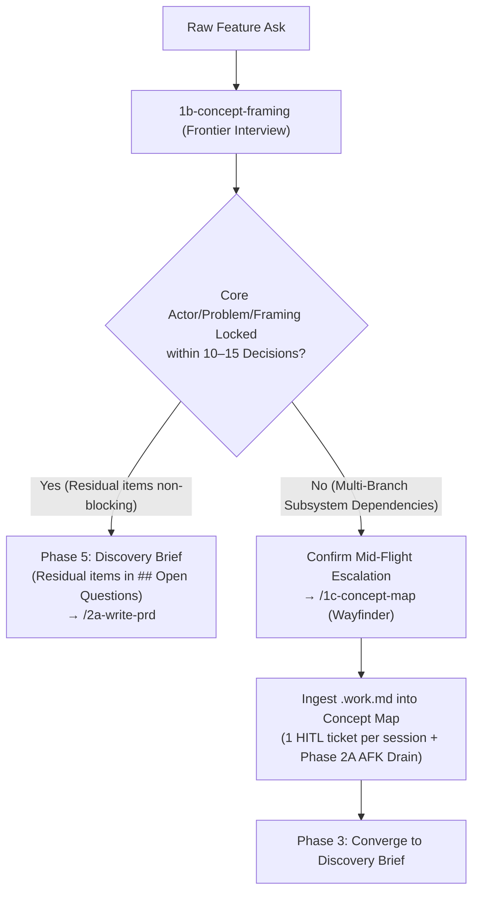

# Research: Frontier Interviewing, Wayfinder Topology, and Fact vs Decision Economics

Question Coverage: Q1 ✓ · Q2 ✓ · Q3 ✓ · Q4 ✓

## 1. Executive Summary

This research evaluates interactive requirement discovery primitives—principally Matt Pocock's `grilling`, `grill-with-docs`, `domain-modeling`, and `wayfinder` skills—to inform the modernization of Stratosphere-OS's `1b-concept-framing` and `1c-concept-map` lifecycle skills under issue **[BT-249](https://github.com/PatN-git/Stratosphere-OS/issues/249)**.

Key findings:
1. **Codebase Fact Discovery is Mandated by Primary Sources (`[HIGH]`):** Upstream `grilling/SKILL.md` explicitly forbids asking users discoverable environment facts, instructing agents to dispatch subagents for silent lookup while continuing to ask independent frontier questions.
2. **The Uncapped Stopping Dilemma (`[MED]`):** While the upstream topological stopping rule (*"Done when the frontier is empty"*) guarantees tree coverage in theory, unconstrained multi-round interviews exceeding 15–20 questions induce **terminal fatigue** and **"just go with it" rubber-stamping (hollow consent)**.
3. **The StratOS Synthesis (`[HIGH]`):** The 10–15 question budget in `1b-concept-framing` acts as an **escalation boundary** to `1c-concept-map` (Wayfinder topology) when multi-subsystem dependency chains remain unresolved, while non-blocking residual questions flow to the discovery brief's `## Open Questions`.
4. **Lossless Mid-Flight Escalation (`[HIGH]`):** When a `1b` framing session cannot lock core Actor, Problem, or Chosen Framing within 10–15 questions due to branching subsystem dependencies, serializing state to `.tmp/1b-discovery-<slug>.work.md` and ingesting `Ask (verbatim)`, `Established Facts`, `Candidate vocabulary`, and `Settled Decisions` into the `concept:map` issue preserves 100% of prior work across sessions.

---

## 2. Primary Source Analysis: Matt Pocock's Skill Suite (`[HIGH]`)

Direct inspection of upstream definitions from `https://github.com/mattpocock/skills` and `https://www.aihero.dev/skills-wayfinder` establishes the author's core mechanics.

### A. Core Grilling (`skills/productivity/grilling/SKILL.md`)
The core primitive models an idea as a **design tree** worked in **rounds**:
- **Frontier Definition:** *"The frontier is every decision whose prerequisites are already settled: the questions you can ask now without guessing at answers you haven't heard yet."*
- **Fact vs. Decision Mandate:**
  > *"Finding facts is your job, never the user's. When a frontier question needs a fact from the environment (filesystem, tools, etc.), dispatch a sub-agent with a fresh context window to find it; don't ask the user for anything you could look up yourself. Don't block on it: a running exploration is an unsettled prerequisite, so only the questions downstream of it wait for the sub-agent to report; ask the rest of the frontier now. The decisions are the user's: put each to them and wait."*
- **Stopping Condition:**
  > *"The session is done when the frontier is empty: every branch of the design tree visited, nothing left silently assumed. Do not act on it until the user confirms you have reached a shared understanding."*

### B. Engineering Extension (`skills/engineering/grill-with-docs/SKILL.md` & `domain-modeling/SKILL.md`)
When operating within an established codebase:
- `grill-with-docs` pairs with `domain-modeling` to enforce Domain-Driven Design (DDD):
  > *"Cross-reference with code: When the user states how something works, check whether the code agrees. If you find a contradiction, surface it: 'Your code cancels entire Orders, but you just said partial cancellation is possible. Which is right?'"*
- Persists settled vocabulary and architectural decisions into `GLOSSARY.md` and decision records.

### C. Wayfinder (`skills/engineering/wayfinder/SKILL.md`)
Recognizing that foggy, multi-subsystem efforts exceed single-session attention, `wayfinder`:
- Charts complex software efforts into an issue-tracker graph of decision, research, prototype, and task tickets.
- Resolves one human-attended decision step per session while allowing background research to run in parallel.
- Treats the map issue as a low-resolution orientation index (Destination, Notes, `Decisions so far`, `Not yet specified`, `Out of scope`) and zooms into full ticket bodies only on demand.

---

## 3. Trade-Off Analysis: Uncapped Frontier vs. Bounded Escalation (`[MED]`)

### A. Strengths of Frontier-Ordered Interviewing
1. **Eliminates Premature Solutioning:** Clarifying prerequisites before downstream leaves prevents building on unverified assumptions.
2. **Code-Grounded Challenge:** Surfacing contradictions between user assumptions and existing schemas/code catches defects before PRD drafting.
3. **Structured Proposals:** Presenting numbered questions with grounded recommendations or trade-off options lets operators confirm sensible defaults rapidly.

### B. Failure Modes of Uncapped Interviews
1. **Terminal Fatigue & Scroll Walls:**
   On non-trivial features, an uncapped design tree can branch into 30–50+ questions across 6–10 rounds, overwhelming standard CLI scroll buffers.
2. **The "Just Go With It" / Hollow Consent Trap:**
   After ~15–20 questions, fatigued operators tend to reply *"sounds good"* or *"whatever you recommend"*. This inverts the purpose of discovery: the human abdicates ownership and the AI makes unilateral architectural choices under nominal consent.
3. **Single-Session Context Drift:**
   Multi-subsystem dependency trees squeezed into one marathon chat session degrade both human attention and conversational focus.

---

## 4. The 10–15 Question Budget & Escalation Boundary Design (`[HIGH]`)

Stratosphere-OS resolves the tension between topological completeness and human attention by treating the **10–15 question budget in `1b-concept-framing` as a structured routing boundary**:

1. **Macro vs. Micro Budgets:**
   - `1b-concept-framing` (Macro): Bounded to 10–15 high-ambiguity decision questions. If core Actor, Problem, and Chosen Framing lock within this envelope, `1b` writes the Discovery Brief directly and places any remaining non-blocking questions in `## Open Questions` (absorbed by `/2a-write-prd` §10).
   - `1c-concept-map` (Micro): Used when multi-branch subsystem dependencies prevent single-session framing. Each ticket is sized to a single ~100k-token session focused on `## Question` (1–3 targeted questions per ticket).
2. **Hollow Consent Guard:**
   `src/references/frontier-interview.md` rejects passive hedges (*"sounds good"*, *"whatever you think"*, *"lgtm"*, silence), requiring the agent to reflect two contrasting trade-offs back to the user and obtain an explicit choice.
3. **Cadence Check-ins:**
   In `1b`, every ~5 questions the agent checks direction: *"Here's what's still fuzzy: [X, Y]. Keep drilling these, or are they intentionally open?"*

---

## 5. Fact vs. Decision Economics (G2 Silent Resolution) (`[HIGH]`)

### Architectural Heuristic
In brownfield repositories, a substantial share (often roughly half) of apparent ambiguity in an initial feature ask consists of **discoverable codebase facts** rather than human decisions:
- Existing data models, column names, and schema constraints
- Active authentication/authorization middleware and route conventions
- Existing configuration keys, environment variable names, and module boundaries

### Impact of G2 (Silent Grep/AST/Probe Resolution)
G2 strictly partitions facts from decisions:
- **Facts (Agent's Job):** Resolved silently before questioning via `grep`, AST inspection, file reads, or a bounded local empirical probe (`probe: <cmd>`, read-only, ≤2 min, in `.tmp/`). Recorded with file/command sources in `## Established Facts`.
- **Decisions (User's Job):** Trade-offs, business intent, scope boundaries, and user experience preferences.

Because G2 removes discoverable fact trivia from the conversation, all 10–15 questions in `1b` (and 1–3 questions per `1c` ticket) are reserved exclusively for genuine architectural and product forks.

---

## 6. Lossless `1b → 1c` Mid-Flight Handover Protocol (`[HIGH]`)

To ensure zero lost work when a `1b` session escalates to `1c`, the handover must preserve every artifact required by `1c` Phase 3's Discovery Brief checklist.

### A. Escalation Trigger Condition
During `1b` Phase 2, if the concept branches into multiple interdependent subsystem frontiers that prevent locking core Actor, Problem, or Chosen Framing within the 10–15 question budget:
1. `1b` serializes all accumulated state into `.tmp/1b-discovery-<slug>.work.md` (`## Ask (verbatim)`, `## Candidate vocabulary`, `## Established Facts`, `## Settled Decisions`, `## Decoupled Follow-ups`, and open frontier questions / fog areas).
2. `1b` asks the user to confirm escalating to `/1c-concept-map` (respecting `AGENTS.md` §1 user-only lifecycle invocation).

### B. Durable Ingestion & Cleanup in `1c` Phase 1
When the user invokes `/1c-concept-map`:
1. **Ingest:** If `.tmp/1b-discovery-<slug>.work.md` is present, `1c` Phase 1 seeds the `concept:map` issue directly from it:
   - `## Ask (verbatim)` ← copied unedited from the work file.
   - `## Notes` (`### Established Facts & Candidate Vocabulary`) ← persists `1b`'s G2 facts (with sources) and candidate `[[G-xxx]]` terms in the map body so they survive across sessions into Phase 3 synthesis.
   - `## Decisions so far` ← records pre-map decisions locked in `1b` as `- [1b handover] <decision> — <gist> (why: <reason>)`.
   - Child `concept:*` tickets and `## Not yet specified (fog)` ← populated from the work file's remaining open questions and fog patches.
2. **Cleanup:** Immediately after `create` of the `concept:map` issue and initial child tickets succeeds, `1c` deletes `.tmp/1b-discovery-<slug>.work.md` so future sessions never re-ingest stale handover state.

## Cost & Viability Signals

- **Token & Session Efficiency:** Offloading codebase fact lookup to G2 (`grep`/AST) and front-loading AFK research/prep in `1c` Phase 2A keeps human-attended sessions bounded to one `mode:HITL` decision ticket at a time (`[HIGH]`).
- **Tracker Infrastructure Cost:** Zero external paid infrastructure required; operates natively over GitHub Issues (`gh`) or the repo-local Git branch store (`issues.py`) (`[HIGH]`).
