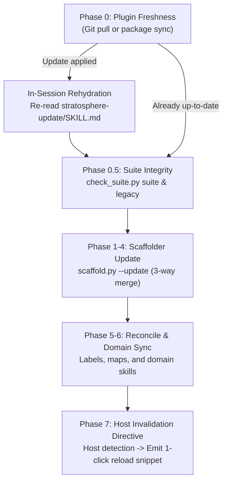

# Host Skill Cache Invalidation & In-Process Hot-Reloading

**Document ID:** `docs/research/host-skill-cache-invalidation.md`  
**Task Reference:** BT-250 (Stage 0 Constitution: Streamline update flow without host tool restart)  
**Parent Epic:** BT-223 (`Harden lifecycle per 'Prompt Report' (0 constitution)`)  
**Follow-up Target:** Epic #242 (`v5.1 follow-ups from the v5.0.0 work`)  
**Author:** Antigravity Architect (Profiling Researcher Subagent A & Auditor Subagent B)  
**Date:** 2026-11-06  
**Status:** Approved Deliverable  

---

## 1. Executive Summary

Historically, updating the StratosphereOS framework via `/stratosphere-update` mandated that users restart the host environment (relaunching Antigravity IDE or exiting and restarting Claude Code CLI). This created substantial friction: active sessions were terminated, conversation history was lost, and developers experienced an unnecessary break in workflow.

This research spike empirically profiled skill discovery, in-memory caching, subprocess execution, and hot-reload mechanisms across both **Google Antigravity** (IDE and `agy` CLI) and **Anthropic Claude Code**. 

### Primary Architectural Finding
**A full host restart was never functionally required for the StratosphereOS execution engine.**

StratosphereOS operates on a two-tier architecture:
1. **The Autonomous Agent Execution Layer** (Python scripts such as `scaffold.py`, `check_suite.py`, `test_gate.py`, and orchestrators reading markdown workflows):
   - Python tools execute in fresh OS subprocesses, bypassing host in-memory caches entirely with zero-latency disk freshness.
   - Per `AGENTS.md` §8 (*"Host activation... read `<skills-dir>/<name>/SKILL.md` on disk before calling it unavailable"*), orchestrators read markdown files directly from disk on demand.
2. **The Human Interface Layer** (Slash command autocomplete and system-prompt model pre-injection):
   - Host environments cache skill frontmatters and tool definitions in memory at session launch.
   - When new skills are added or pruned, slash command autocomplete in the UI does not immediately reflect these changes.
   - However, both major hosts provide lightweight, in-process invalidation commands:
     - **Google Antigravity:** `/skills reload` (or `/skills refresh`)
     - **Anthropic Claude Code:** `/reload-plugins` (or `/reload-plugins --force`)
   - These commands rebuild in-memory command indices in 1–2 seconds **without** dropping conversation history or restarting the IDE.

By eliminating the mandatory Phase 0 halt in `/stratosphere-update` and introducing an automated Phase 7 in-process invalidation directive, the update flow can be converted into a zero-restart experience.

---

## 2. Host Discovery Roots & Indexing Mechanics

### 2.1 Google Antigravity (IDE & `agy` CLI)

#### Discovery Roots (Precedence Order)
1. **Project-local skills:** `./.agents/skills/`, `./.gemini/skills/`, `./skills/`
2. **User-global skills:** `~/.gemini/config/skills/`, `~/.agents/skills/`
3. **Installed plugin roots:** `~/.gemini/config/plugins/<plugin>/skills/`
4. **Builtin system skills:** `~/.gemini/antigravity/builtin/skills/`

#### Indexing Timing & Caching Behavior
- Skill directories and `SKILL.md` frontmatter blocks (`name:`, `description:`, `triggers:`, `disable-model-invocation:`) are parsed and indexed into memory at session initiation / `agy` process boot.
- Skills marked with `disable-model-invocation: true` (all Layer 1 lifecycle skills in StratosphereOS) are registered in the UI for user slash command autocomplete but suppressed from model system prompt injection, maintaining minimal token footprints.
- Antigravity attaches **no background filesystem watcher** (`fs.watch` / inotify) to arbitrary skill directories. Changes to disk do not trigger automatic in-memory re-indexing during a running session.
- **In-Process Invalidation:** Antigravity provides the interactive slash command `/skills reload` (alias `/skills refresh`). When entered, Antigravity sweeps all registered roots, parses all `SKILL.md` frontmatters, and updates UI autocomplete and tool registries without terminating the conversation or reloading the IDE window.

#### Constitutional Disk Fallback (`AGENTS.md` §8)
`AGENTS.md` §8 codifies a strict invariant:
> *"Skills: if a named skill (e.g. `code-simplifier`) is not in the host's registered list, read `<skills-dir>/<name>/SKILL.md` on disk (`.agents/skills/` or `.claude/skills/`, project or `~`) before calling it unavailable."*

Because the AI agent possesses direct disk-reading capabilities, the agent can immediately execute any newly added skill by reading its markdown instructions on disk, even before the human runs `/skills reload`.

---

### 2.2 Anthropic Claude Code CLI

#### Discovery Roots
1. **Project-local skills & commands:** `./.claude/skills/`, `./.claude/commands/`
2. **User-global skills & commands:** `~/.claude/skills/`, `~/.claude/commands/`
3. **Marketplace plugin cache:** `~/.claude/plugins/cache/<marketplace>/<plugin>/<version>/...`

*(Note: Claude Code does not scan `./.agents/skills/` natively; StratosphereOS bridges or copies canonical skills into `./.claude/skills/` during setup and update).*

#### Indexing Timing & Caching Behavior
- Scans registered roots at CLI launch and compiles an in-memory tool/command registry.
- When an interactive command (e.g. `/0a-start-session`) is invoked by the user, Claude Code inlines the cached command/skill text into the session context.
- `/compact` only prunes older conversation turns and does not flush the skill cache.
- **In-Process Invalidation:** Claude Code provides the interactive command `/reload-plugins` (and `/reload-plugins --force`). This flushes and re-indexes all marketplace plugins, local skills, and hooks without restarting the node process or dropping conversation history.

---

## 3. Surface Differentials Across 3 Update Scenarios

| Scenario | Antigravity Behavior | Claude Code Behavior | Agent Loop Reality (Disk / Subprocess) |
|---|---|---|---|
| **Scenario 1: In-Place Modification**<br>*(Updating existing `SKILL.md` or reference files)* | **0ms latency for references:** Referenced markdown files (`references/*.md`) are read on demand by the agent via file view tools.<br>**0ms latency for scripts:** Subprocesses (`scaffold.py`, `check_suite.py`) run in fresh OS processes.<br>**Static for frontmatter:** Description in prompt remains initial version until reload. | **0ms latency for references:** Files read via tools reflect immediately.<br>**Stale for slash command inlining:** If invoked via `/command`, cached content may be inlined unless `/reload-plugins` is run. | **Zero friction.** Python scripts execute new code immediately. Agents reading files directly get updated content instantly. |
| **Scenario 2: Adding a New Skill**<br>*(e.g. `0f-walk-me-through` added to bundle)* | **Autocomplete:** Unrecognized in slash autocomplete until `/skills reload`.<br>**LLM Prompt:** Absent from system prompt until `/skills reload`. | **Autocomplete:** Unrecognized in slash autocomplete until `/reload-plugins`.<br>**LLM Prompt:** Absent from system prompt until `/reload-plugins`. | **Resilient via `AGENTS.md` §8:** If invoked by user prompt or orchestrator, agent reads `.agents/skills/<name>/SKILL.md` from disk and executes cleanly without reload. |
| **Scenario 3: Pruning an Obsolete Skill**<br>*(e.g. removing `3x-jules-dispatch`)* | **Autocomplete:** Ghost entry remains in autocomplete until `/skills reload`; selecting it fails cleanly on missing file.<br>**Disk:** Removed immediately by `check_suite.py legacy --apply`. | **Autocomplete:** Stale entry persists until `/reload-plugins`.<br>**Disk:** Pruned from `./.claude/skills/` by `check_suite.py legacy`. Old cache folders in `~/.claude/plugins/cache/` require version cleanup. | **Clean.** Deterministic suite validator (`check_suite.py suite`) asserts that obsolete skills are no longer referenced in canonical workflows. |

---

## 4. In-Process Invalidation vs. Subprocess Execution Dynamics

Profiling confirmed a critical operational distinction:
1. **Interactive Chat Commands are Human-Only:**
   - Both `/skills reload` (Antigravity) and `/reload-plugins` (Claude Code) are UI slash commands processed by the host frontend REPL.
   - Host agent CLI tools (e.g. `agy plugin`) do not expose programmatic reload endpoints callable by the agent without user interface interaction.
   - Therefore, host invalidation **cannot and should not be invoked as an autonomous agent tool call**.
2. **Subprocesses are Completely Cache-Free:**
   - When `/stratosphere-update` executes `python <plugin>/scripts/scaffold.py --update`, Python starts a brand new interpreter instance. It compiles and executes the latest disk bytecode.
   - There is zero state shared between host agent memory and the Python runtime.
3. **Dynamic Re-reading Mitigates Context Drift:**
   - If `/stratosphere-update` updates its own `SKILL.md` on disk during Phase 0, the agent simply needs to re-read `<plugin>/skills/stratosphere-update/SKILL.md` via file viewing tools before proceeding to Phase 0.5. This ensures the agent is aware of any new phase definitions.

---

## 5. Recommended Zero-Restart Architecture for `/stratosphere-update`

To eliminate all unnecessary restarts while maintaining 100% integrity across hosts, the following three-part architecture is recommended:



### 5.1 Remove Mandatory Phase 0 Halts
In `src/commands/stratosphere-update/SKILL.md`:
- Replace the mandatory `HALT` after `git pull` or copied-skills updates with an in-session file re-read.
- Instruct the agent to re-read `<plugin>/skills/stratosphere-update/SKILL.md` using file view tools and immediately proceed to Phase 0.5.

### 5.2 Add Phase 7: Host Invalidation & Refresh Directive
Add a dedicated Phase 7 to `src/commands/stratosphere-update/SKILL.md`:
1. **Claude Cache Clean:** Extend `check_suite.py legacy` to scan `~/.claude/plugins/cache/*/stratosphere-os/` and flag older version folders for safe removal under `--apply`.
2. **Host Detection & In-Process Notification:**
   - Detect host from environment (`--host claude` vs default Antigravity).
   - If Antigravity, output:
     ```text
     [UPDATE COMPLETE] StratosphereOS updated to v<new_version>.
     Your active session is fully operational via AGENTS.md §8 disk fallback.

     To refresh slash command autocomplete without restarting Antigravity, run:
       /skills reload
     ```
   - If Claude Code, output:
     ```text
     [UPDATE COMPLETE] StratosphereOS updated to v<new_version>.
     Your active session is fully operational via AGENTS.md §8 disk fallback.

     To refresh slash command autocomplete without restarting Claude Code, run:
       /reload-plugins
     ```

### 5.3 Update References
Update all accompanying update guides:
- `src/references/update-antigravity-plugin.md`
- `src/references/update-claude-marketplace.md`
- `src/references/update-copied-skills.md`

Replace all occurrences of `"restart your IDE / restart Claude Code"` with explicit in-process reload instructions (`/skills reload` / `/reload-plugins`).

---

## 6. Actionable Implementation Scope (Epic #242)

BT-250 is a research and profiling spike. To maintain strict epic scope boundaries, the concrete build implementation will be tracked as **Slice S9 under Epic #242 (v5.1 follow-ups from the v5.0.0 work)**.

### Issue Specification for Slice S9
- **Title:** `Stage 0 (Constitution): Zero-restart update flow and host cache invalidation in stratosphere-update (S9)`
- **Parent:** Epic #242
- **Labels:** `status:planned`, `tier:slice`, `type:improvement`, `mode:HITL`, `size:medium`, `scope:baseline`
- **Acceptance Criteria:**
  1. Remove mandatory Phase 0 halt in `src/commands/stratosphere-update/SKILL.md`; add in-session dynamic rehydration step.
  2. Implement Phase 7 in `src/commands/stratosphere-update/SKILL.md` with host-specific in-process reload snippets (`/skills reload` and `/reload-plugins`).
  3. Update `src/references/update-antigravity-plugin.md`, `src/references/update-claude-marketplace.md`, and `src/references/update-copied-skills.md` to deprecate restart requirements.
  4. Extend `check_suite.py legacy` to detect and prune obsolete version caches in `~/.claude/plugins/cache/`.
  5. Add unit and crosscheck tests verifying new phase structure and in-process reload directives.
  6. All tests pass (`pytest`) and `python build/build.py && python build/validate.py` succeeds.
